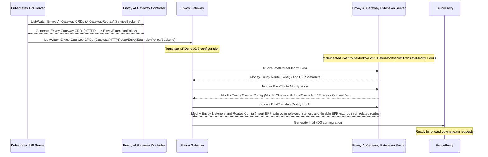
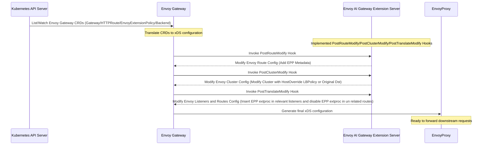
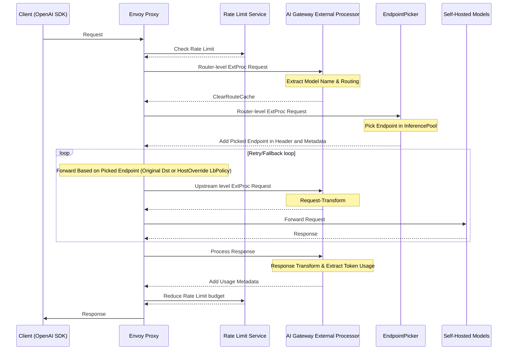
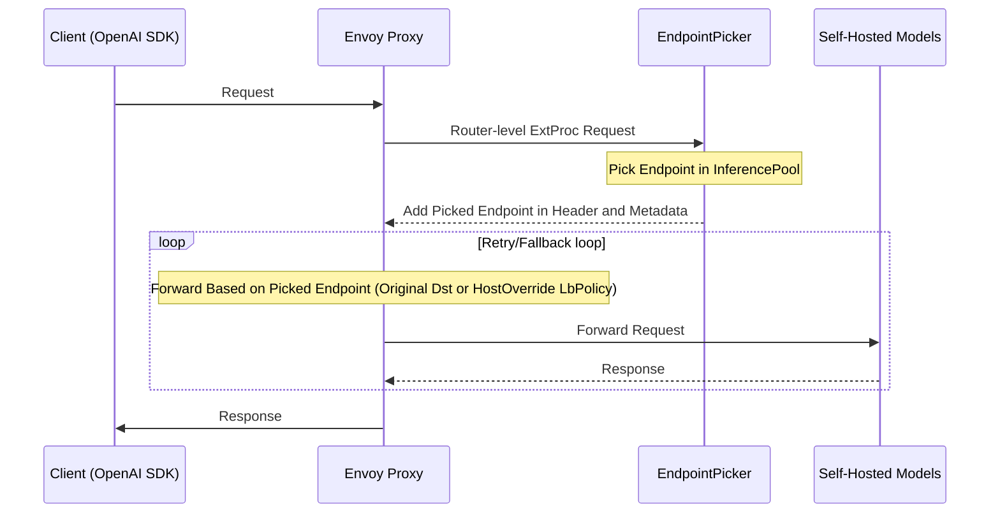

# Support Integration with Endpoint Picker (GIE)

- author: [Xunzhuo](https://github.com/xunzhuo)

## Table of Contents

<!-- toc -->

- [Summary](#summary)
- [Goals](#goals)
- [Background](#background)
  - [How EPP works?](#how-epp-works)
  - [How Envoy works with GIE](#how-envoy-works-with-gie)
- [Design](#design)
  - [Resource Relation](#resource-relation)
  - [Configuration Generation](#configuration-generation)
  - [Work with Envoy Gateway](#work-with-envoy-gateway)
- [Final Workflow](#final-workflow)
- [Implementation Considerations and Limitations](#implementation-considerations-and-limitations)
- [Non-GIE EPP Integration](#non-gie-epp-integration)

<!-- /toc -->

## Summary

This propopal aims to land integration with other endpoint picker in Envoy AI Gateway, expand EAGW abilities with other EPP implementations, like Gateway API Inference Extension, AIBrix Plugin, semantic router etc.

This is a core functionality in EAGW`s vision, make the routing more intelligent.


## Goals

- Integrate with EPP to expand the Envoy AI Gateway abilities
- Integrate with the existing CRD and features well
- Support InferencePool in AIGatewayRoute
- Support InferencePool in HTTPRoute

## Background

Before starting the design of EAGW + GIE integration, let us figure out how GIE works with DP Envoy and CP.

### How EPP works?

Take the [Gateway API Inference Extension](https://gateway-api-inference-extension.sigs.k8s.io/) as an example:


When request goes to envoyproxy, it goes to the http filter chain, the ext-proc filter calls an ext-proc upstream cluster, which connects to an external gRPC service, we call that endpoint picker(EPP).

The gRPC service info is pre-defined in [InferencePool](https://gateway-api-inference-extension.sigs.k8s.io/api-types/inferencepool/) extensionRef, giving an example below:

```
apiVersion: inference.networking.k8s.io/v1
kind: InferencePool
metadata:
  name: vllm-llama3-8b-instruct
spec:
  targetPortNumber: 8000
  selector:
    app: vllm-llama3-8b-instruct
  extensionRef:
    name: vllm-llama3-8b-instruct-epp
    port: 9002
    failureMode: FailClose
```

The control plane will generate the corresponding ext proc config (filter + cluster) to envoy, Take the inferencePool above as an example, the destination would be `vllm-llama3-8b-instruct-epp:9002` in the same namespace with the InferencePool.

Based on the routing rules, the CP patches the ext-proc per-route config to the routes, and when request is matched with the rule, the request goes to the EPP(ext-proc). Take the HTTPRoute as an example, the CP will apply the per-route ext-proc filter according to the `/` matches rule.

```
apiVersion: gateway.networking.k8s.io/v1
kind: HTTPRoute
metadata:
  name: llm-route
spec:
  parentRefs:
  - group: gateway.networking.k8s.io
    kind: Gateway
    name: inference-gateway
  rules:
  - backendRefs:
    - group: inference.networking.k8s.io
      kind: InferencePool
      name: vllm-llama3-8b-instruct
    matches:
    - path:
        type: PathPrefix
        value: /
    timeouts:
      request: 300s
```

Then when requests go to EPP, it calculates the best match backend inference endpoint among the inference pool based on the the [InferencePool](https://gateway-api-inference-extension.sigs.k8s.io/api-types/inferencepool/) Selector.

Take the inferencePool above as an example, the pods are selected by label `app=vllm-llama3-8b-instruct`.

When EPP decides which endpoint (use `1.2.3.4` as an example) is the best, it patches the existing connections with some tricks like

1. adding headers: `x-gateway-destination-endpoint`:`1.2.3.4`
1. adding metadata: `envoy.lb`: `1.2.3.4`

Then everything the EPP can do is done, envoyproxy is going to work, the logics is the next section.

### How Envoy works with GIE?

EnvoyProxy is the data plane who actually forwards the request, unlike the ways we forward the traffic to the kubernetes service/endpoints, the destination is unknown for the control plane, so it cannot be pre-generated to EnvoyProxy.

Above section tells, the destination is chosen by EPP and the information is located in header and metadata, so the way envoy determines is to read the header or the metadata to pick the target endpoint.

There are two approaches envoy can work in this scenario:

#### Based on LoadBalancingPolicy of override_host

For more details see: [docs](https://www.envoyproxy.io/docs/envoy/latest/api-v3/extensions/load_balancing_policies/override_host/v3/override_host.proto#extensions-load-balancing-policies-override-host-v3-overridehost)

example:

```
  loadBalancingPolicy:
    policies:
    - typedExtensionConfig:
        name: envoy.load_balancing_policies.override_host
        typedConfig:
          '@type': type.googleapis.com/envoy.extensions.load_balancing_policies.override_host.v3.OverrideHost
          overrideHostSources:
          - header: x-gateway-destination-endpoint
```

#### Based on ORIGINAL_DST Cluster

For more details see: [docs](https://www.envoyproxy.io/docs/envoy/latest/intro/arch_overview/upstream/load_balancing/original_dst#arch-overview-load-balancing-types-original-destination)

example:

```
        name: original_destination_cluster
        type: ORIGINAL_DST
        original_dst_lb_config:
          use_http_header: true
          http_header_name: x-gateway-destination-endpoint
        connect_timeout: 6s
        lb_policy: CLUSTER_PROVIDED
        dns_lookup_family: V4_ONLY
```

## Design

This section discusses how Envoy AI Gateway integrates with EPP.

### Resource Relation

Envoy AI Gateway currently provides a special xRoute called AIGatewayRoute, take a quick Look:

```
apiVersion: aigateway.envoyproxy.io/v1alpha1
kind: AIGatewayRoute
metadata:
  name: envoy-ai-gateway-basic
  namespace: default
spec:
  schema:
    name: OpenAI
  targetRefs:
    - name: envoy-ai-gateway-basic
      kind: Gateway
      group: gateway.networking.k8s.io
  rules:
    - matches:
        - headers:
            - type: Exact
              name: x-ai-eg-model
              value: gpt-4o-mini
      backendRefs:
        - name: envoy-ai-gateway-basic-openai
```

The backendRef is default referred with the AIServiceBackend:

```
apiVersion: aigateway.envoyproxy.io/v1alpha1
kind: AIServiceBackend
metadata:
  name: envoy-ai-gateway-basic-openai
  namespace: default
spec:
  schema:
    name: OpenAI
  backendRef:
    name: envoy-ai-gateway-basic-openai
    kind: Backend
    group: gateway.envoyproxy.io
  backendSecurityPolicyRef:
    name: envoy-ai-gateway-basic-openai-apikey
    kind: BackendSecurityPolicy
    group: aigateway.envoyproxy.io
```

To integrate with the GIE, there are two options:

#### Option 1: Add InferencePool as an backendRef on AIGatewayRoute Level

This requires to expand the `AIGatewayRouteRuleBackendRef` with `BackendObjectReference`

##### Example

- When it matches gpt-4o-mini goes to AIServiceBackend `envoy-ai-gateway-basic-openai`
- When it matches vllm-llama3-8b-instruct goes to InferencePool `vllm-llama3-8b-instruct`

```
apiVersion: inference.networking.k8s.io/v1
kind: InferencePool
metadata:
  name: vllm-llama3-8b-instruct
spec:
  targetPortNumber: 8000
  selector:
    app: vllm-llama3-8b-instruct
  extensionRef:
    name: vllm-llama3-8b-instruct-epp
    port: 9002
    failureMode: FailClose
---
apiVersion: aigateway.envoyproxy.io/v1alpha1
kind: AIGatewayRoute
metadata:
  name: envoy-ai-gateway-basic
  namespace: default
spec:
  schema:
    name: OpenAI
  targetRefs:
    - name: envoy-ai-gateway-basic
      kind: Gateway
      group: gateway.networking.k8s.io
  rules:
    - matches:
        - headers:
            - type: Exact
              name: x-ai-eg-model
              value: gpt-4o-mini
      backendRefs:
        - name: envoy-ai-gateway-basic-openai
    - matches:
        - headers:
            - type: Exact
              name: x-ai-eg-model
              value: vllm-llama3-8b-instruct
      backendRefs:
        - name: vllm-llama3-8b-instruct
        	group: inference.networking.k8s.io
          kind: InferencePool
```

#### Option 2: Add InferencePool as an backendRef on AIServiceBackend Level

This requires to expand the `AIServiceBackend` backendRef supports the InferencePool, considering current AIServiceBackend BackendRef is `gwapiv1.BackendObjectReference`, so we don't need any changes on it.

#### Conclusion

We will adopt **Option 1: Add InferencePool as a backendRef on AIGatewayRoute Level**.

This approach is preferred because InferencePool resources do not require BackendSecurityPolicy or schema configuration. The implementation assumes OpenAI format compatibility, which aligns with the Gateway API Inference Extension (GAIE) design principles.

##### Example

- When it matches gpt-4o-mini goes to AIServiceBackend `envoy-ai-gateway-basic-openai`
- When it matches vllm-llama3-8b-instruct goes to AIServiceBackend `vllm-llama3-8b-instruct`

```yaml
apiVersion: inference.networking.k8s.io/v1
kind: InferencePool
metadata:
  name: vllm-llama3-8b-instruct
spec:
  targetPortNumber: 8000
  selector:
    app: vllm-llama3-8b-instruct
  extensionRef:
    name: vllm-llama3-8b-instruct-epp
    port: 9002
    failureMode: FailClose
---
apiVersion: aigateway.envoyproxy.io/v1alpha1
kind: AIGatewayRoute
metadata:
  name: envoy-ai-gateway-basic
  namespace: default
spec:
  schema:
    name: OpenAI
  targetRefs:
    - name: envoy-ai-gateway-basic
      kind: Gateway
      group: gateway.networking.k8s.io
  rules:
    - matches:
        - headers:
            - type: Exact
              name: x-ai-eg-model
              value: gpt-4o-mini
      backendRefs:
        - name: envoy-ai-gateway-basic-openai
    - matches:
        - headers:
            - type: Exact
              name: x-ai-eg-model
              value: vllm-llama3-8b-instruct
      backendRefs:
        - name: vllm-llama3-8b-instruct
---
apiVersion: aigateway.envoyproxy.io/v1alpha1
kind: AIServiceBackend
metadata:
  name: vllm-llama3-8b-instruct
spec:
  schema:
    name: OpenAI
  backendRef:
    name: vllm-llama3-8b-instruct
    group: inference.networking.k8s.io
    kind: InferencePool
```

#### Configuration Generation

no matter which one we decide for the above two approaches, we need to figure out how/what configuration we need to generate.

based on the background, we need to generate such configurations:

##### ext-proc config

- generate ext-proc cluster based on the InferencePool extensionRef
- generate ext-proc http filter based on the InferencePool extensionRef

##### route level config

- patch the ext-proc filter into the route configuration based on which route the InferencePool is linked with
- add the cluster with loadbalancing policy or ORIGINAL_DST to understand the header and route `x-gateway-destination-endpoint`

#### Resource Generation

This section is about how to manage the GIE kubernetes resource, in short, there are two approaches, static or dynamic.

- static: end-user manage the GIE deployment, service etc resource.
- dynamic: end-user do not care about the life cycle of GIE resources, Envoy AI Gateway take care of that.

#### Conclusion

For the initial implementation, we will adopt the **static approach** to manage EPP lifecycle. This decision is based on implementation complexity considerations and allows users to pre-deploy EPP resources. Dynamic resource management will be considered for future iterations based on user requirements and feedback.

This approach aligns with industry practices where external inference framework controllers typically manage EPP deployment logic. For reference, KServe implements EPP deployment through their `LLMInferenceService` API, demonstrating that EPP lifecycle management is better handled at the inference framework level rather than within Envoy AI Gateway. See [KServe LLMInferenceService](https://github.com/kserve/kserve/blob/master/pkg/apis/serving/v1alpha1/llm_inference_service_types.go#L171) for implementation details.

#### Working with Envoy Gateway

There are some work-in-process PRs in upstream:

- https://github.com/envoyproxy/gateway/pull/6271
- https://github.com/envoyproxy/gateway/pull/6342
- https://github.com/envoyproxy/gateway/pull/6524

##### Backend + EEP

Reference: https://github.com/envoyproxy/gateway/pull/6271

The first one, introduces a new Backend Type called HostOverride, it can be referred by HTTPRoute:

```yaml
 apiVersion: gateway.envoyproxy.io/v1alpha1
  kind: Backend
  metadata:
    name: backend-routing-based-on-header
    namespace: default
  spec:
    type: HostOverride
    hostOverrideSettings:
      overrideHostSources:
      - header: x-gateway-destination-endpoint
```

It adds the the cluster with override_host loadBalancingPolicy, we can add the host based routing strategy like above, routing based on the endpoint in header `x-gateway-destination-endpoint`

Take the configuration below as an example:

```yaml
apiVersion: inference.networking.k8s.io/v1
kind: InferencePool
metadata:
  name: vllm-llama3-8b-instruct
spec:
  targetPortNumber: 8000
  selector:
    app: vllm-llama3-8b-instruct
  extensionRef:
    name: vllm-llama3-8b-instruct-epp
    port: 9002
    failureMode: FailClose
---
apiVersion: aigateway.envoyproxy.io/v1alpha1
kind: AIGatewayRoute
metadata:
  name: envoy-ai-gateway-basic
  namespace: default
spec:
  schema:
    name: OpenAI
  targetRefs:
    - name: envoy-ai-gateway-basic
      kind: Gateway
      group: gateway.networking.k8s.io
  rules:
    - matches:
        - headers:
            - type: Exact
              name: x-ai-eg-model
              value: vllm-llama3-8b-instruct
      backendRefs:
        - name: vllm-llama3-8b-instruct
        	group: inference.networking.k8s.io
          kind: InferencePool
```

When EAGW found this situation, it will generate HTTPRoute + Backend + EPP:

```yaml
apiVersion: gateway.networking.k8s.io/v1
kind: HTTPRoute
metadata:
  name: envoy-ai-gateway-basic
spec:
  parentRefs:
    - group: gateway.networking.k8s.io
      kind: Gateway
      name: envoy-ai-gateway-basic
      namespace: default
  rules:
    - backendRefs:
        - group: gateway.envoyproxy.io
          kind: Backend
          name: vllm-llama3-8b-instruct
          weight: 1
      filters:
        - extensionRef:
            group: gateway.envoyproxy.io
            kind: HTTPRouteFilter
            name: ai-eg-host-rewrite
          type: ExtensionRef
      matches:
        - headers:
            - name: x-ai-eg-selected-route
              type: Exact
              value: envoy-ai-gateway-basic-rule-0
          path:
            type: PathPrefix
            value: /
    - matches:
        - path:
            type: PathPrefix
            value: /
      name: unreachable
---
apiVersion: gateway.envoyproxy.io/v1alpha1
kind: Backend
metadata:
  name: vllm-llama3-8b-instruct
spec:
  type: HostOverride
  hostOverrideSettings:
    overrideHostSources:
      - header: x-gateway-destination-endpoint
---
apiVersion: gateway.envoyproxy.io/v1alpha1
kind: EnvoyExtensionPolicy
metadata:
  name: vllm-llama3-8b-instruct
spec:
  targetRef:
    group: gateway.networking.k8s.io
    kind: HTTPRoute
    name: envoy-ai-gateway-basic
  extProc:
    - backendRefs:
        - name: vllm-llama3-8b-instruct-epp
          port: 9002
      processingMode:
        request:
          body: Buffered
        response:
          body: Streamed
      messageTimeout: 5s
```

This direction is to reuse the capabilities of Envoy Gateway and generate the Backend and EnvoyExtensionPolicy to manage the InferencePool.

But it cannot provide rule-level InferencePool support. EnvoyExtensionPolicy can only target `HTTPRoute`/`Gateway`, therefore it cannot support multiple `InferencePool` resources or mixed use `AIServiceBackend` in one AIGatewayRoute.

##### EnvoyExtensionServer

The second one, introduces the abilities for define the custom BackendRef in Envoy Gateway, and send that with the gRPC call, and the extension server in Envoy AI Gateway, edits the cluster/route and send it back to Envoy Gateway xDS translator.

Reference: https://github.com/envoyproxy/gateway/pull/6342

Cluster Modify Workflow is like:

**Envoy Gateway**

1. enabled the XDSCluster, XDSRoute level XDSTranslatorHook, and define the custom backend resource in Envoy Gateway configuration (InferencePool CRD)
2. Envoy Gateway will start to watch the InferencePools
3. If httproute refers any resource with the same GVK, carry it with ExtensionRefs IR
4. When EG doing xDS translation, checks if ExtensionRefs > 0, if so, it calls the PostClusterModifyHook and carry the unstructuredResources(InferencePool) to Envoy AI Gateway

**Envoy AI Gateway**

PostClusterModify Hook logics:

1. Implement the PostClusterModifyHook, iterates the unstructuredResources to group the inferencePool(only support one InferencePool per route rule)
2. Modify the cluster type with ORIGINAL_DST, and add the original_dst_lb_config
3. Send it back to Envoy Gateway

```yaml
type: ORIGINAL_DST
original_dst_lb_config:
  use_http_header: true
  http_header_name: x-gateway-destination-endpoint
connect_timeout: 6s
lb_policy: CLUSTER_PROVIDED
```

PostRouteModify Hook logics:

1. Modify the route metadata with InferencePool info
2. Send it back to Envoy Gateway

```yaml
metadata:
  filter_metadata:
    aigateway.envoy.io:
      per_route_rule_inference_pool: default/vllm-llama3-8b-instruct/vllm-llama3-8b-instruct-epp/9002
```

PostTranslateModify Hook logics:

1. Find inferencepool relevant listener based on route metadata.
2. Insert epp extproc configs into listener.
3. Find unrelated routes under relevant listener.
4. Insert extproc perroute to disable these routes.
5. Send it back to Envoy Gateway

After all Hooks logics, Envoy Gateway xDS Server pushes the config to EnvoyProxy.

#### Conclusion

We will adopt the **EnvoyExtensionServer approach** for integrating with Envoy Gateway. This decision is based on several factors:

- **API Stability**: The extension server approach provides better stability compared to direct API modifications
- **Flexibility**: Offers more control over custom backendRef handling through the extension server mechanism
- **Conformance**: Enables passing Gateway API conformance tests without requiring modifications ([#648](https://github.com/envoyproxy/ai-gateway/issues/648))
- **Maintainability**: Reduces coupling with upstream Envoy Gateway API changes

We can natively support HTTPRoute + InferencePool as well as the AIGatewayRoute + InferencePool.

Configuration for AIGatewayRoute + InferencePool is like:

```yaml
apiVersion: aigateway.envoyproxy.io/v1alpha1
kind: AIGatewayRoute
metadata:
  name: inference-pool-with-aigwroute
  namespace: default
spec:
  schema:
    name: OpenAI
  targetRefs:
    - name: inference-pool-with-aigwroute
      kind: Gateway
      group: gateway.networking.k8s.io
  rules:
    - matches:
        - headers:
            - type: Exact
              name: x-ai-eg-model
              value: meta-llama/Llama-3.1-8B-Instruct
      backendRefs:
        - group: inference.networking.k8s.io
          kind: InferencePool
          name: vllm-llama3-8b-instruct
    - matches:
        - headers:
            - type: Exact
              name: x-ai-eg-model
              value: mistral:latest
      backendRefs:
        - group: inference.networking.k8s.io
          kind: InferencePool
          name: mistral
    - matches:
        - headers:
            - type: Exact
              name: x-ai-eg-model
              value: some-cool-self-hosted-model
      backendRefs:
        - name: envoy-ai-gateway-basic-testupstream
```

Configuration for HTTPRoute + InferencePool is like:

```yaml
apiVersion: gateway.networking.k8s.io/v1
kind: HTTPRoute
metadata:
  name: inference-pool-with-httproute
  namespace: default
spec:
  parentRefs:
    - group: gateway.networking.k8s.io
      kind: Gateway
      name: inference-pool-with-httproute
      namespace: default
  rules:
    - backendRefs:
        - group: inference.networking.k8s.io
          kind: InferencePool
          name: vllm-llama3-8b-instruct
          namespace: default
          weight: 1
      matches:
        - path:
            type: PathPrefix
            value: /
      timeouts:
        request: 60s
```

## Logic Workflow

The complete integration workflow follows these steps:

1. **Extension Server Setup**: Enable Envoy Gateway extension server with InferencePool backend resource support
2. **Resource Installation**: Deploy Gateway API Inference Extension (GIE) resources including CRDs and controller deployment
3. **InferencePool Configuration**: Create InferencePool resource referencing the external processing service
4. **Route Configuration**: Configure InferencePool as AIGatewayRoute backend (limited to one InferencePool per route rule)
5. **HTTPRoute Generation**: Envoy AI Gateway synchronizes configuration to managed HTTPRoute with InferencePool BackendRef
6. **Invoke Cluster/Route/Listener Hooks**: Envoy Gateway invokes PostClusterModify/PostRouteModify/PostTranslateModify hook.
7. **Cluster/Route/Listener Configuration**: Envoy AI Gateway configures Original Destination cluster with `x-gateway-destination-endpoint` header matching, and modifies Listener and Routes in a reverse approach (Enable epp extproc in Listener level and disabled the extproc in unrelated routes for preventing clearRouteCache`s impact)
8. **Request Processing**: Client requests flow through EnvoyProxy to EPP service, which adds destination headers and metadata for endpoint selection

The logics flow for AIGatewayRoute + InferencePool is like:



The logics flow for HTTPRoute + InferencePool is like:



## Request Flow

The request flow for AIGatewayRoute + InferencePool is like:



The request flow for HTTPRoute + InferencePool is like:



## Implementation Considerations and Limitations

Current implementation is able to support InferencePool using AIGatewayRoute as well as HTTPRoute.

But there are some advantages for AIGatewayRoute + InferencePool:

- Native OpenAI Support: we can use native Open AI Spec to call different inference pool in a same listener, because we support to parse the mode from the body, and refresh the cache with route level ai-gw extproc. But using HTTPRoute directly cannot do that, it has to add more routeMatch to do it in a same listener like headerMatch, or separate it into different listeners.
- Token Ratelimit: we can support token ratelimit, for the self hosted models, we can extract the token usage from the response and reduce the rate limit budget.
- Advanced Observability: we can expose more metrics in our ai-gw ext-proc.

### Load Balancing Policy

The initial implementation will use **Original Destination** cluster configuration for endpoint selection. Future iterations may consider **Host Override** policy as an alternative approach based on performance and operational requirements.

### Fallback Support

Envoy Gateway's native fallback mechanism operates within a single cluster using multiple backends as separate `localityLBEndpoints`. However, InferencePool integration presents architectural constraints:

- InferencePool cannot coexist with standard AIServiceBackends in a single route rule
- The cluster configuration requires Original Destination or Host Override setup, which conflicts with standard multi-backend configurations
- Cross-provider fallback scenarios are not supported in the initial implementation

This limitation will be documented, and potential solutions using aggregate clusters may be explored in future releases.

### Token Rate Limiting

Token-based rate limiting for InferencePool is supported through proper upstream external processing filter configuration. The implementation must ensure upstream `extproc` filters are correctly inserted, following the same pattern used in the current extension server implementation.

### Documented Limitations

The following limitations must be clearly documented for users:

#### Cross-Provider Fallback Restriction

Cross-provider fallback functionality is not supported when using InferencePool due to Envoy cluster configuration constraints at both Envoy Gateway and extension server levels. This limitation may be addressed in future releases if Envoy Gateway supports aggregate cluster configurations or alternative extension server-level solutions.

#### Single Backend Constraint

Users cannot define multiple InferencePool resources or combine InferencePool with standard AIServiceBackends within a single route rule. This restriction will be enforced through Kubernetes CEL validation.

**Technical Rationale**: Multi-backend route rules assume an Envoy cluster contains multiple backends as `LocalityLbEndpoints`, where each backend's metadata distinguishes the corresponding AIServiceBackend for external processing logic. InferencePool's Original Destination cluster configuration is incompatible with this multi-backend model, and Envoy Gateway's fallback/priority mechanisms operate at the cluster level.

## Non-GIE EPP Integration

This section outlines the requirements and integration process for custom Endpoint Picker Provider (EPP) implementations beyond the Gateway API Inference Extension.

### EPP Selection Mechanism

EPP selection is configured through `InferencePool.spec.extensionRef` as defined in the [Gateway API Inference Extension specification](https://gateway-api-inference-extension.sigs.k8s.io/reference/spec/#extensionreference). This design is implementation-agnostic, allowing users to specify their own EPP deployments while maintaining compatibility with the InferencePool API.

### Requirements for Custom EPP Implementation

Custom EPP implementations must satisfy the following technical requirements:

- **External Processing Server**: Must implement the Envoy external processing (ext-proc) gRPC protocol
- **Endpoint Selection**: Must add the `x-gateway-destination-endpoint` header to request headers for endpoint routing
- **InferencePool API Awareness**: Must understand InferencePool resource specifications to:
  - Enable Envoy AI Gateway to establish ext-proc server connections
  - Determine which routes require ext-proc filter attachment
  - Configure Original Destination clusters with `x-gateway-destination-endpoint` header matching

### Integration Workflow

The integration process for custom EPP implementations follows these steps:

1. **Deployment**: Deploy the custom EPP service implementing the ext-proc protocol
2. **Resource Configuration**: Create InferencePool resource referencing the custom EPP service
3. **Route Binding**: Link the InferencePool to AIGatewayRoute backend configuration
4. **Request Processing**: Incoming requests are processed through the following flow:
   - EnvoyProxy receives client request
   - Request is forwarded to custom EPP ext-proc server
   - EPP analyzes request and adds `x-gateway-destination-endpoint` header
   - EnvoyProxy routes request to the selected endpoint based on the header value
