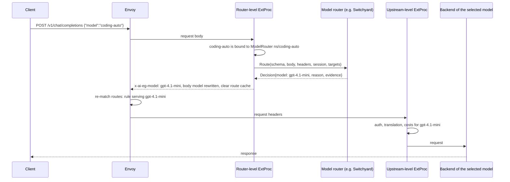

# Model Routing with a Pluggable `ModelRouter` and NVIDIA NeMo Switchyard

## Status

Proposed. Implemented as a `v1alpha1` API, targeting the next minor release.

## Summary

This proposal adds **virtual models** to Agent Router. A client requests a model name such as
`coding-auto`, and a **model router** selects, for each request, which real model serves it. The
gateway rewrites the requested model to the selected one and routes the request normally, so the
selected model's credentials, translation, quotas, costs and metrics apply unchanged.

Model routers are configured with a new `ModelRouter` resource (`aigateway.envoyproxy.io/v1alpha1`).
An `AIGatewayRoute` rule references it as a `backendRef`, the same way it references an
`InferencePool`. The decision is made by a pluggable implementation selected by `spec.type`.

The first implementation embeds [NVIDIA NeMo Switchyard](https://github.com/NVIDIA-NeMo/Switchyard)
in the external processor. Switchyard is an open-source library of routing algorithms that pick
between efficient and capable models from the request and the agent's recent tool activity.

## Motivation

Agentic workloads mix steps that need very different amounts of model capability. Reading files or
applying a known fix can be done by a small model; recovering from repeated test failures or
planning a change benefits from a frontier model. Sending every step to the capable model is
expensive; sending every step to the efficient one hurts task success.

Today Agent Router can only split traffic by weight or by priority (failover). It cannot choose a
model from what a request contains. Clients have to pick the model themselves, and gateway
operators have no way to apply a cost/quality policy centrally.

Switchyard implements this kind of routing as a library, designed to be embedded where model
requests are dispatched: "after request admission and input decoding, before model dispatch". Its
published benchmarks on Terminal-Bench 2.1 and DeepSWE show routed configurations reaching
close to the capable model's task success at a fraction of the cost. Agent Router is that place in
many deployments, and it already owns everything Switchyard expects the host to own: credentials,
model inventory, quotas, cost tracking and observability.

## Goals

- Let operators define virtual models whose requests are routed, per request, between target
  models served by the same Gateway.
- Keep every existing per-model behavior: once routed, a request is handled exactly as if the
  client had requested the selected model.
- Make the routing implementation pluggable: adding another router (for example the Jev decision
  model) must be a new implementation, without changes to the API shape, the controller, the filter
  configuration or the external processor integration.
- Embed Switchyard for the algorithms that decide without calling a model (`auto`,
  `stage_router` without a classifier, `random`, `plan_execute`, `passthrough`).
- Pass session and agent identity to stateful algorithms, scoped per tenant.
- Expose routing decisions in metrics, traces, request headers and access logs.
- Keep the build of Agent Router independent of Rust: no vendored Switchyard code, and builds
  without Switchyard support keep working.

## Non-goals

- Routing-time model calls (LLM judges, decision models). The interface reserves a hook for them,
  but this proposal does not implement it. See [Future work](#future-work).
- Algorithms that produce the answer during routing (escalation, advisor, VGR).
- Excluding targets based on quota or health.
- Sharing session state across external processor replicas.
- Switchyard's prefill routing, which needs model activations and trained checkpoints.

## Background: how Switchyard works

Switchyard's Rust core, `libsy`, runs an algorithm over a request and a pool of models grouped by
category (`efficient`, `capable`, `judge`, `any`). The algorithm produces a stream of steps for the
host:

- `Done(outcome)`: the routing decision. It holds the ordered selected models (the first is the
  choice, the rest are fallbacks), the request to send (possibly changed, for example with a
  handoff note), and metadata with the algorithm name and decision evidence.
- `CallModel` / `CallDecision`: the algorithm asks the host to call a model, or a typed decision
  model, and waits for the answer before continuing.

The algorithms fall in three groups, which determine what a host needs to support:

| Group                 | Algorithms                                                                 | Host work                                                    |
| --------------------- | -------------------------------------------------------------------------- | ------------------------------------------------------------ |
| Decision-only         | `auto`, `stage_router` (no judge), `random`, `plan_execute`, `passthrough` | Supply the request; read the decision.                       |
| Judge first           | `llm_classifier`, `composite`, `stage_router` with a classifier            | Serve judge calls, then read the decision.                   |
| Answer during routing | escalation, `advisor`, `vgr`                                               | Serve answer calls inside the run; the answer is the result. |

`auto` is a preset of `stage_router`. It scores the tool-result history of the conversation:
error severity, "spinning" and exploration push toward the capable tier; a high share of writes and
edits with no recent errors pushes toward the efficient tier. It is pure CPU work over the request
body, with no network call.

Switchyard provides Go bindings (`bindings/go`). By default they run `libsy` compiled to
WebAssembly with [wazero](https://wazero.io), a pure-Go runtime, so no cgo is needed. The API is
`switchyard.New(config)` and `router.Route(ctx, Input{Request, Models, Metadata}, hostCall)`, plus
codecs between the OpenAI Chat, OpenAI Responses and Anthropic Messages formats and Switchyard's
protocol. The binding keeps a pool of `GOMAXPROCS` WebAssembly instances; requests with the same
session ID always use the same instance, which is where per-session algorithm state lives.

## Integration opportunities considered

Several integrations between Agent Router and Switchyard are possible:

1. **Embedded routing in the external processor for decision-only algorithms.** Covered by this
   proposal.
2. **Routing-time model calls through the gateway.** The external processor serves judge and
   decision calls by sending them back through the gateway, so they get credentials, quotas and cost
   tracking. This unlocks judge-based algorithms and decision models such as Jev. Next step.
3. **Answer-producing algorithms.** Needs buffered answers produced inside the external processor;
   deferred.
4. **Quota- and health-aware candidate pools.** Exclude exhausted or unhealthy targets from the
   models given to the router. Builds on this proposal.
5. **Session identity and observability.** Covered by this proposal.
6. **No-code options.** Running Switchyard's standalone server in front of, or behind, Agent Router
   works today, but Switchyard documents that server as demo-only, and it bypasses per-model
   controls.

## Architecture



| Component                       | Responsibility                                                                                                           |
| ------------------------------- | ------------------------------------------------------------------------------------------------------------------------ |
| `ModelRouter` resource          | Targets, failure handling, session headers and implementation configuration.                                             |
| Controller                      | Validates `ModelRouter`s and writes them, and the virtual model bindings, to the filter configuration of each Gateway.   |
| Router-level external processor | Finds the router bound to the requested model, asks it for a decision, applies it to the request, and records telemetry. |
| Model router implementation     | Makes the decision. It does not call providers or touch the request pipeline.                                            |
| Rules of the target models      | Everything after the decision: credentials, translation, quotas, costs, fallbacks.                                       |

## API design

### `ModelRouter`

```go
type ModelRouterSpec struct {
	// Type selects the implementation. Enum: Switchyard.
	Type ModelRouterType `json:"type"`
	// Targets are the candidate models: names served by rules on the same Gateway.
	// listType=map, listMapKey=model, 1 to 32 items.
	Targets []ModelRouterTarget `json:"targets"`
	// DefaultModel is used when the router fails and FailureMode is UseDefault.
	DefaultModel *string `json:"defaultModel,omitempty"`
	// FailureMode: UseDefault (default when DefaultModel is set) or Reject (503).
	FailureMode *ModelRouterFailureMode `json:"failureMode,omitempty"`
	// Session configures the session and agent identity headers.
	Session *ModelRouterSession `json:"session,omitempty"`
	// Switchyard configures the Switchyard implementation. Required when Type is Switchyard.
	Switchyard *SwitchyardModelRouterConfig `json:"switchyard,omitempty"`
}

type ModelRouterTarget struct {
	Model       string  `json:"model"`                 // e.g. "gpt-4.1-mini"
	Role        string  `json:"role"`                  // implementation-defined, e.g. "efficient"
	Description *string `json:"description,omitempty"` // for routers that describe candidates
}

type ModelRouterSession struct {
	IDHeader       *string  `json:"idHeader,omitempty"`       // then x-switchyard-session-id, agent-session-id
	ScopeHeaders   []string `json:"scopeHeaders,omitempty"`   // e.g. a tenant header
	AgentIDHeader  *string  `json:"agentIDHeader,omitempty"`  // default x-switchyard-agent-id
	SubagentHeader *string  `json:"subagentHeader,omitempty"` // default x-switchyard-is-subagent
}

type SwitchyardModelRouterConfig struct {
	// Algorithm is passed to Switchyard as-is. It must be an object with a "type".
	Algorithm apiextensionsv1.JSON `json:"algorithm"`
}
```

CEL rules enforce that the implementation block matches `type`, that `defaultModel` is one of the
targets, and that `UseDefault` has a `defaultModel`. Status reports `Accepted` or `NotAccepted` with
the validation error. The fields above the implementation block are vendor-neutral on purpose:
`role` and `description` are interpreted by each implementation.

The Switchyard algorithm is kept untyped because Switchyard is pre-1.0 and its configuration
schema changes between releases. The controller checks that it is an object with a `type`; the
external processor validates it fully when it builds the router.

### Example

```yaml
apiVersion: aigateway.envoyproxy.io/v1alpha1
kind: ModelRouter
metadata:
  name: coding-auto
  namespace: ml-platform
spec:
  type: Switchyard
  targets:
    - model: qwen3-coder
      role: efficient
    - model: claude-opus
      role: capable
  defaultModel: claude-opus
  session:
    idHeader: x-session-id
    scopeHeaders: [x-tenant-id]
  switchyard:
    algorithm:
      type: stage_router
      picker: efficient_first
      confidence_threshold: 0.6
---
apiVersion: aigateway.envoyproxy.io/v1beta1
kind: AIGatewayRoute
metadata:
  name: llm
  namespace: team-a
spec:
  parentRefs:
    - name: ai-gateway
      kind: Gateway
      group: gateway.networking.k8s.io
  rules:
    # Tenant variant: the same virtual model, a cheaper policy for the free tier.
    - matches:
        - headers:
            - name: x-ai-eg-model
              value: coding-auto
            - name: x-tier
              value: free
      backendRefs:
        - name: coding-auto-free
          group: aigateway.envoyproxy.io
          kind: ModelRouter
    - matches:
        - headers:
            - name: x-ai-eg-model
              value: coding-auto
      backendRefs:
        - name: coding-auto
          namespace: ml-platform
          group: aigateway.envoyproxy.io
          kind: ModelRouter
    - matches:
        - headers:
            - name: x-ai-eg-model
              value: qwen3-coder
      backendRefs:
        - name: vllm-qwen
    - matches:
        - headers:
            - name: x-ai-eg-model
              value: claude-opus
      backendRefs:
        - name: anthropic
---
# Allows the cross-namespace reference above.
apiVersion: gateway.networking.k8s.io/v1beta1
kind: ReferenceGrant
metadata:
  name: allow-model-routers
  namespace: ml-platform
spec:
  from:
    - group: aigateway.envoyproxy.io
      kind: AIGatewayRoute
      namespace: team-a
  to:
    - group: aigateway.envoyproxy.io
      kind: ModelRouter
```

### `AIGatewayRoute` changes

- The backendRef group/kind rule now also allows `aigateway.envoyproxy.io`/`ModelRouter`.
- The existing rules that restrict a rule to one InferencePool and forbid mixing it with
  `AIServiceBackend`s only check whether group and kind are set, so they apply to `ModelRouter`
  references unchanged. Their messages now mention both kinds.
- A new rule rejects `modelNameOverride`, `headerMutation` and `bodyMutation` on `ModelRouter`
  references. They belong on the rules of the target models.
- `IsAIServiceBackend()` was `!IsInferencePool()`. It is now "no group and kind, or the
  `AIServiceBackend` kind", so that `ModelRouter` references are not treated as backends anywhere.
  `IsModelRouter()` and `HasModelRouterBackends()` are added.

## API alternatives considered

**A. Inline field on `AIGatewayRouteRule`** (`modelRouter:` instead of `backendRefs`). Least
machinery, but it puts vendor-specific, fast-changing configuration into the `v1beta1` API, ties the
routing policy to the route owner, and cannot be reused across routes.

**B. `ModelRouter` resource referenced as a `backendRef` (chosen).** The routing policy has its own
owner, RBAC, lifecycle and status, and can be shared across routes and namespaces with
ReferenceGrants. Rule matching is unchanged, so per-tenant or per-hostname variants come for free.
It follows the `InferencePool` precedent: an InferencePool picks an endpoint within a model, a
`ModelRouter` picks a model. The churn of Switchyard stays in a `v1alpha1` kind.

**C. Policy attached to routes or Gateways** (`targetRefs`, adds virtual models). No rule slots are
used, but it inverts policy attachment (policies change their target, they do not create routable
names), hides virtual models from readers of the route, needs its own conflict and matching rules,
and has no natural per-request variation.

|                      | A: inline | B: backendRef | C: attached policy                |
| -------------------- | --------- | ------------- | --------------------------------- |
| Separate ownership   | No        | Yes           | Yes                               |
| Reusable             | No        | Yes           | Yes                               |
| Per-tenant variants  | Native    | Native        | Needs own matching                |
| Visible in the route | Yes       | Yes           | No                                |
| `v1beta1` churn      | High      | One CEL rule  | None                              |
| Precedent            | None      | InferencePool | Policy attachment, used unusually |

## Pluggable router interface

The external processor only knows the vendor-neutral `internal/modelrouter` package:

```go
type Router interface {
	Route(ctx context.Context, req *Request) (*Decision, error)
	Close() error
}

type Request struct {
	Schema       Schema // openai_chat | openai_responses | anthropic_messages
	VirtualModel string
	Body         []byte            // raw client body, read-only
	Headers      map[string]string // read-only
	Session      Session           // tenant-scoped ID, agent ID, sub-agent flag
	Targets      []Target          // model, role, description
}

type Decision struct {
	Model     string            // must be one of the targets
	Fallbacks []string          // informational
	Body      []byte            // optional rewritten body, same schema
	Reason    string            // low-cardinality, e.g. "stage_router"
	Evidence  map[string]string // traces only
}

type Factory func(cfg *Config, deps Deps) (Router, error) // Config.Config is the raw implementation block

func Register(typ string, f Factory) // from an implementation's init()

type Deps struct {
	Logger     *slog.Logger
	Dispatcher Dispatcher // nil until routing-time calls are supported
	Observer   Observer
}

type Dispatcher interface {
	// Call sends body to a gateway path for a model, through the regular request pipeline.
	Call(ctx context.Context, model, path string, body []byte) ([]byte, error)
}

type Observer interface {
	ObserveDecision(ctx context.Context, event *DecisionEvent) // router, type, models, reason, outcome, duration
}
```

The package wraps every implementation with the behavior they all share, so implementations stay
small:

- **Target validation.** A decision for a model that is not a target is a failure.
- **Failure handling.** Router errors, factory errors and unknown types follow the failure mode:
  `UseDefault` routes to the default model, `Reject` returns 503. A broken router never prevents the
  others from loading.
- **Session resolution.** The tenant-scoped session ID and agent identity are resolved from headers
  before the router is called.
- **Reload.** `NewSet(prev, ...)` reuses a router whose type, targets and configuration did not
  change, so in-memory sessions survive unrelated configuration changes. Each router is
  reference-counted across sets and closed when no set holds it. Replaced sets are released after a
  one-minute grace period, so requests that started with the previous configuration can finish.
- **Observation.** Every decision is reported to the `Observer`, which records the metrics.

### Adding another router: Jev

[Jev](https://typesafe.ai) is a decision model reached through TypeSafe System One. Agent Router
already proxies `/typesafe/v1/systemone` to `TypeSafe` backends. A Jev router would be added with:

1. `api/v1alpha1/model_router.go`: a `Jev` enum value, a `Jev *JevModelRouterConfig` block (decision
   model name, cutoff) and a CEL rule tying it to the type.
2. `internal/controller/model_router.go`: validation and conversion of the new block in
   `validateModelRouter` and `modelRouterFilterConfig`.
3. `internal/modelrouter/jev`: a `Router` that builds a System One request from the conversation and
   the target descriptions, sends it with `deps.Dispatcher.Call(ctx, decisionModel,
"/typesafe/v1/systemone", body)`, applies the cutoff and returns a `Decision`, registered with
   `modelrouter.Register("Jev", ...)`.

The `ModelRouter` shape, the filter configuration, the controller's binding logic and the external
processor hook do not change. The only shared prerequisite is the `Dispatcher` implementation, which
is also what Switchyard's judge-based algorithms need.

## Filter configuration and controller

The filter configuration gains two fields:

```go
ModelRouters        []ModelRouter        // name "<ns>/<name>", type, targets, defaultModel,
                                         // failureMode, session, config (raw JSON)
ModelRouterBindings []ModelRouterBinding // virtualModel, hostnames, headers, router, routeName
```

**Why bindings repeat the rule's matches.** The router-level external processor runs before Envoy
selects the final route, so it cannot know which rule matched from xDS attributes. Instead the
controller copies each rule's matching conditions into a binding: the exact `x-ai-eg-model` value
(the virtual model), the route hostnames, and the other header matches (exact or regular
expression). The external processor evaluates bindings in rule order and uses the first one that
matches. This keeps per-tenant variants working.

**HTTPRoute generation.** A `ModelRouter` rule is generated without backends. Requests for the
virtual model are always rewritten (or answered directly) by the external processor before Envoy
re-selects the route, so the rule is never used to reach an upstream; a request that reaches it
without being rewritten gets a direct error response. The rule is still generated, rather than
skipped, because the extension server maps clusters back to `AIGatewayRoute` rules by index. No
Envoy Gateway extension resource, cluster or extension server change is needed.

**Indexing and watches.** AIGatewayRoutes are indexed by the `ModelRouter`s they reference, in a
separate index from the AIServiceBackend one so that resources with the same name do not collide. A
`ModelRouter` controller validates routers, sets their status, and re-syncs the referencing routes
(and so their Gateways) when a router changes or is deleted. Cross-namespace references are
validated with ReferenceGrants. Targets that are not served on the Gateway are logged.

## Execution and error semantics

The routing step runs in the router-level `ProcessRequestBody`, after the body is parsed and before
the `x-ai-eg-model` header is set and the request span starts:

1. If the requested model has no binding matching the request, nothing changes.
2. Endpoints opt in through an optional `endpointspec.ModelRoutable` interface, implemented by
   Chat Completions, Responses and Anthropic Messages. A virtual model on another endpoint returns 400.
3. The router decides. A rejection returns 503.
4. The decision is applied:
   - The body is the router's rewritten body if any, otherwise the client's, with `model` set to the
     selected model. It is parsed again with the endpoint's parser, which keeps endpoint-specific
     body handling (such as forcing `stream_options.include_usage`).
   - Body mutation is forced, because same-schema translators otherwise forward the original body,
     which names the virtual model.
   - The original model stays the virtual model. The model header carries the selected model, so
     the GenAI metrics record `gen_ai.original.model=<virtual>` and
     `gen_ai.request.model=<selected>` with no change to the metrics code.
5. The route cache is cleared, as today, and Envoy routes to the selected model's rule. Retries and
   fallbacks re-use the rewritten body.

The routing decision is made once per request. Fallbacks within the selected model's rule (priority
and retries) work as usual; Switchyard's suggested fallback models are not used yet.

## Session identity and observability

**Session identity.** The session ID is the first non-empty value of `session.idHeader`,
`x-switchyard-session-id` and `agent-session-id` (the gateway's default session header for traces).
When `scopeHeaders` are configured, their values are prepended with a separator that cannot appear
in headers, so equal session IDs from different tenants never collide. Agent ID and sub-agent flag
are read from their headers. Switchyard receives them as request metadata, which also pins a session
to one WebAssembly instance.

**Telemetry.**

- Metrics:
  - `agent_router.model_router.decisions`: counter with name, type, virtual model, selected model,
    reason and outcome (`routed`, `default`, `rejected`).
  - `agent_router.model_router.duration`: decision time histogram.
  - All label values come from configuration or from a bounded set, so cardinality is bounded.
- Traces: an optional `tracingapi.ModelRouterSpan` interface (like the existing `BackendSpan`)
  records `agent_router.model_router.{name,type,virtual_model,selected_model,reason,outcome}` and
  `agent_router.model_router.evidence.*` on the request span.
- Request headers: `x-ai-eg-model-router`, `x-ai-eg-model-router-reason` and
  `x-ai-eg-virtual-model`, which operators can map to metric, span and log attributes with the
  existing request header attribute flags.
- Dynamic metadata in `io.envoy.ai_gateway`: `model_router_name`, `model_router_virtual_model`,
  `model_router_selected_model` and `model_router_reason`, for access logs.

## Build and packaging

The Switchyard Go module embeds a WebAssembly module that is built from Rust and not published, so
it cannot be used directly from the Go module cache. Rather than vendoring Switchyard code or
committing a binary:

- `go.mod` requires `github.com/NVIDIA-NeMo/Switchyard/bindings/go` at a pinned commit
  (pseudo-version).
- The Switchyard implementation (`internal/modelrouter/switchyard`) and its registration in the
  external processor are behind the `switchyard` build tag. The configuration logic that does not
  depend on Switchyard is untagged and tested in every build.
- `make build-switchyard` runs `tools/switchyard/build.sh`, which fetches only the pinned commit
  into the git-ignored `out/switchyard/<commit>`, builds the WebAssembly module with Switchyard's
  pinned Rust toolchain (local `rustup`, or a Docker container), and writes `out/switchyard/go.work`,
  a Go workspace that replaces the module with that checkout. It does nothing when the commit is
  already prepared.
- `make build.extproc` and `make build.aigw` use the workspace and the tag when
  `ENABLE_SWITCHYARD=true` (the default). The container images are built from those binaries, so
  they include Switchyard. `ENABLE_SWITCHYARD=false` builds without it and never fetches.
- `make check-switchyard-pin`, part of `make precommit`, checks that the Makefile commit and the
  `go.mod` version agree.

Builds without the tag (`go build ./...`, `go test ./...`, linting, IDEs) do not compile Switchyard
and need neither Rust nor the WebAssembly module. In such a build, `Switchyard` model routers are
unavailable: their requests follow their failure mode, and an error is logged when the configuration
loads.

## Testing and rollout

- Unit tests:
  - `internal/modelrouter` (lookup, failure modes, session scoping, router reuse and release).
  - The Switchyard configuration mapping.
  - The external processor hook, with a test-only router type.
  - Metrics and spans.
  - Controller: HTTPRoute generation, filter configuration, ModelRouter reconciler, indexes and
    ReferenceGrants.
- Tagged unit tests run Switchyard itself (`make test-switchyard`): random, passthrough and `auto`,
  including an `auto` request with failing tool calls that selects the capable model.
- CEL tests cover the `ModelRouter` and `AIGatewayRoute` validation rules.
- Data-plane tests run Envoy and the external processor: failure modes without any implementation,
  and Switchyard algorithms with the tag (`make test-data-plane` sets it). They check the rewritten
  body and headers at the upstream, translation to another schema, and the decision metrics.

The API is `v1alpha1`. It can change based on feedback, in particular once routing-time model
calls land.

## Compatibility and limitations

- Existing configurations are unaffected: no field changes meaning, and a rule without a
  `ModelRouter` reference behaves as before.
- Only decision-only Switchyard algorithms are supported. Others make the router unavailable.
- Session state lives in each external processor instance and is not shared across replicas.
  Session affinity at the load balancer is recommended for stateful algorithms. Changing a
  `ModelRouter`, or a crash of a WebAssembly instance, resets its sessions.
- Signal-based algorithms are calibrated for tool-using coding agents: plain chat traffic goes to
  the efficient tier.
- Switchyard is pre-1.0. Its algorithm configuration is passed through, so a Switchyard upgrade can
  change which configurations are valid.
- Building with Switchyard needs Rust (`rustup`) or Docker.

## Future work

- A `Dispatcher` that sends routing-time model calls back through the gateway, with a marker that
  skips model routing. It enables Switchyard's judge-based algorithms and a Jev router, with
  credentials, quotas and costs applied to judge calls, and routing cost reported separately.
- Answer-producing algorithms (escalation, advisor).
- Candidate pools that exclude targets with exhausted quota or unhealthy backends.
- Session state shared outside the process.
- An `aigw run` preset with an efficient and a capable virtual model for coding agents.

## Open questions

- Should target models be checked against the whole Gateway, as now, or only against the routes
  that reference the router?
- Should the response `model` report the virtual model or the served one? Coding agents' status
  lines tend to want the served model; some clients expect the requested name back. Today the
  served model is returned.
- Can Switchyard publish a Go module that includes the WebAssembly module? That would remove the
  build step.
