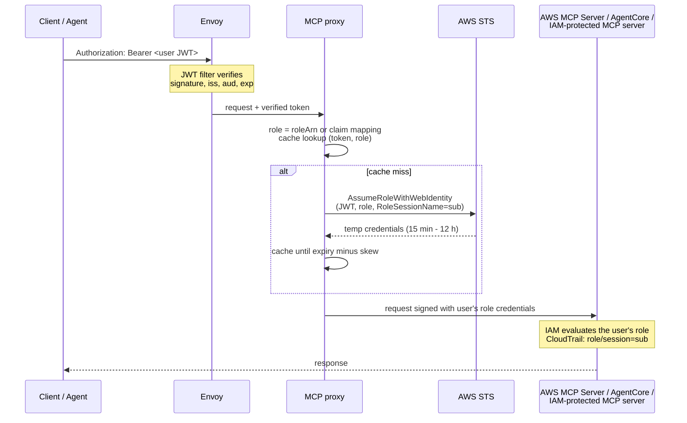

# Per-User AWS Credentials for MCP Backends via Web Identity Federation

## Status

Draft (not yet discussed upstream)

## Table of Contents

1. [Summary](#summary)
   - 1.1 [Motivation](#11-motivation)
   - 1.2 [Use cases](#12-use-cases)
   - 1.3 [When you don't need this](#13-when-you-dont-need-this)
2. [How It Works Today](#how-it-works-today)
   - 2.1 [MCP backends: no AWS support](#21-mcp-backends-no-aws-support)
   - 2.2 [What LLM routes already have](#22-what-llm-routes-already-have)
   - 2.3 [What is missing](#23-what-is-missing)
3. [How the Proposal Works](#how-the-proposal-works)
   - 3.1 [Idea](#31-idea)
   - 3.2 [Request flow](#32-request-flow)
   - 3.3 [API](#33-api)
   - 3.4 [AWS-side setup](#34-aws-side-setup)
   - 3.5 [Trust policies](#35-trust-policies)
   - 3.6 [Credential caching](#36-credential-caching)
   - 3.7 [Security rules](#37-security-rules)
   - 3.8 [Failure modes](#38-failure-modes)
4. [Today vs. Proposed](#today-vs-proposed)
5. [Alternatives Considered](#alternatives-considered)
6. [Prototype and Validation](#prototype-and-validation)
7. [Relation to Other Work](#relation-to-other-work)
8. [Open Questions](#open-questions)
9. [Delivery Plan](#delivery-plan)
10. [Future Work: LLM Routes to Bedrock](#future-work-llm-routes-to-bedrock)

## Summary

MCP backends have no AWS support. MCP servers that require AWS SigV4 (the AWS MCP Server, Bedrock
AgentCore Gateway and Runtime, Lambda function URLs and API Gateway with IAM auth) cannot sit behind
an `MCPRoute`.

This proposal adds `awsCredentials` to `MCPBackendSecurityPolicy`, so the MCP proxy signs backend
requests with SigV4. With `awsCredentials.webIdentity`, the credentials belong to the calling user:
the MCP proxy exchanges the user's verified JWT with `sts:AssumeRoleWithWebIdentity` for short-lived
credentials of an IAM role, and signs the request with them. The result:

- Every AWS call is made as an IAM role chosen for that user or agent, so permissions are scoped by IAM.
- CloudTrail shows who made each call (`RoleSessionName` comes from the user's `sub`).
- No extra service to build, deploy, or secure.

### 1.1 Motivation

Teams put agent-router in front of their AI traffic so that one place handles login, tool access,
rate limits and audit. AWS breaks that model. Today the gateway can only reach AWS as **itself**:
every developer, chat user or agent behind it becomes the same IAM principal. That has three
consequences:

- **Least privilege is impossible.** The gateway's role must be the union of everything any caller
  might need. An intern's agent and the platform team's agent can do the same things in AWS.
- **CloudTrail can't say who did it.** Every call shows the gateway role. "Who restarted the payments
  service?" has no answer in AWS.
- **The gateway becomes a high-value target.** Long-lived, broad AWS credentials sit in the gateway.

The usual workarounds each give up part of what the gateway is for:

- Writing an `ext_authz` service that verifies the user and calls STS means building and securing a
  custom credential broker. For MCP routes it would also need a way to pass credentials to the MCP
  proxy, which doesn't exist yet (Alternatives, option B).
- Giving each developer local AWS credentials and a signing proxy (`mcp-proxy-for-aws`) moves AWS
  access out of the gateway entirely, together with its policies and logs.

AWS already has the right primitive for this: `sts:AssumeRoleWithWebIdentity`. It turns a token from
the company's identity provider into short-lived credentials for one IAM role, and records the user
in CloudTrail. The gateway already verifies that same token (`MCPRoute.securityPolicy.oauth`). This
proposal connects the two.

### 1.2 Use cases

**Company-wide AI gateway in front of AWS.** Security requires all agent traffic to go through one
gateway, for audit, tool allowlists, rate limits, and a single kill switch. Developers in Cursor or
Claude reach CloudWatch and ECS through the gateway's MCP endpoint and log in once with Okta.
Everyone calls AWS as their own team's role: `dev` reads only dev logs, `platform` can also restart
services. The gateway stays in the path, and AWS still enforces per-user permissions.

**One MCP endpoint for many tools.** A single `MCPRoute` combines the AWS MCP Server, GitHub, Jira,
and internal tools behind one URL and one login. AWS's own OAuth for the AWS MCP Server issues tokens
only for that server, so a gateway that combines backends can't use them. The gateway has to sign
the AWS part itself.

**Shared agents serving many people.** A Slack bot, an internal chat UI (Open WebUI, LibreChat) or an
agent platform runs as one service but acts for many employees. With this feature, the service
passes the asking user's token. AWS then applies that user's role, so the same bot can show Bob's
team production logs and deny the intern. The bot itself holds no AWS credentials.

**MCP servers hosted behind IAM auth.** MCP servers on Lambda function URLs (`AWS_IAM`), API Gateway
with IAM auth, or VPC Lattice only accept SigV4. The gateway decides who may call them, and the
server receives the caller's verified IAM identity for its own checks and logs.

**Several AWS accounts.** Different backends map the same teams to roles in different accounts
(dev, staging, prod). "Platform may write in dev but only read in prod" becomes configuration.

### 1.3 When you don't need this

AWS MCP Server supports OAuth through AWS Sign-in
([OAuth 2.1 authentication for AWS MCP Server](https://docs.aws.amazon.com/agent-toolkit/latest/userguide/oauth-authentication.html)).
A developer can point Cursor or Claude directly at `https://aws-mcp.<region>.api.aws/mcp`, sign in
with their existing IAM user, IAM Identity Center or federated identity, and act with their own
permissions, with no gateway involved. For a team that only needs that one server and doesn't route
traffic through a gateway, that is simpler, and this proposal adds nothing.

This proposal is for deployments where the gateway is, or should be, in the path: combined
endpoints, shared agents, self-hosted IAM-protected MCP servers, organizations that restrict AWS
Sign-in OAuth (`signin:AuthorizeOAuth2Access`), and multiple accounts.

## How It Works Today

### 2.1 MCP backends: no AWS support

`MCPBackendSecurityPolicy` has a single field:

```go
type MCPBackendSecurityPolicy struct {
	APIKey *MCPBackendAPIKey `json:"apiKey,omitempty"`
}
```

So MCP servers that require SigV4 (AWS MCP Server, Bedrock AgentCore Gateway/Runtime with IAM
inbound auth, Lambda function URLs and API Gateway with IAM auth) cannot sit behind an `MCPRoute`.
Clients either run a local signing proxy such as `mcp-proxy-for-aws` with their own AWS credentials,
or, for the AWS MCP Server only, connect to it directly with AWS Sign-in OAuth (section 1.3).
Both paths bypass the gateway. #2181 (MCP SigV4 with the gateway identity) was closed without review, and proposal
[010](../010-mcp-token-exchange/proposal.md) (RFC 8693 token exchange) only covers bearer-token
backends and is not implemented.

What MCP routes *do* have is client-side JWT verification (`MCPRoute.spec.securityPolicy.oauth`). The
verified `sub` is already projected into a gateway-set header (`internalapi.MCPSubjectHeader`) that the
MCP proxy trusts, so the gateway already knows who the user is.

### 2.2 What LLM routes already have

LLM routes (`AIGatewayRoute` with a `BackendSecurityPolicy` of type `AWSCredentials`) already sign
Bedrock requests with SigV4, using one gateway identity: static keys, the default credential chain,
or `oidcExchangeToken`, where the controller calls `AssumeRoleWithWebIdentity` with the gateway's own
OIDC client. #2253, #2509 and #2540 added `credentialOverride`, which signs with per-request
credentials that an operator's `ext_authz` service supplies.

This proposal doesn't change LLM routes. It reuses their fail-closed rule for MCP: when per-user
credentials can't be obtained, the request fails instead of being signed as the gateway.

### 2.3 What is missing

| Capability | MCP routes today |
| --- | --- |
| SigV4 with the gateway identity | No |
| SigV4 with per-user credentials | No |
| Gateway obtains a per-user AWS credential itself | No |

## How the Proposal Works

### 3.1 Idea

The MCP proxy already builds a fresh request for every backend, so it is the natural place to sign.
Two additions:

1. `awsCredentials` on `MCPBackendSecurityPolicy`: SigV4 signing with a fixed identity (a credentials
   file or the default credential chain).
2. `awsCredentials.webIdentity`: the MCP proxy exchanges the caller's verified token for credentials
   of an IAM role, caches them, and signs with them.

Why the MCP proxy signs, and not Envoy:

- **The proxy has everything SigV4 needs.** It holds the request body, and the verified token
  reaches it, because Envoy Gateway configures `jwt_authn` with `Forward: true`. Every backend call
  happens inside a client request, so the token is always at hand.
- **The client's token never reaches the backend.** The proxy builds a new request for each backend
  with only MCP headers and any configured `forwardHeaders`.
- **Envoy can't do it today.** Envoy Gateway doesn't expose Envoy's `aws_request_signing` filter, and
  that filter has no per-request credential source. `credentialInjection`, which `apiKey` uses, only
  sets static values. The AI Gateway ext_proc doesn't run on MCP backend clusters.
- **The signature has to cover what Envoy sends upstream.** The proxy sends to the local backend
  listener, and Envoy then rewrites the host to the `Backend` hostname and the path to
  `backendRef.path`. The controller passes those values to the proxy, which signs for them. Envoy
  only adds unsigned headers afterwards (`x-forwarded-*`, `x-request-id`).

The backend must be an Envoy Gateway `Backend` with a single FQDN endpoint, so the signed host is
known. A dynamic module on the backend listener (option C under Alternatives) could take over
signing later.

### 3.2 Request flow



`AssumeRoleWithWebIdentity` is an unsigned STS call, so the gateway needs no AWS credentials of its own
for this path.

### 3.3 API

The first step adds `awsCredentials` to `MCPBackendSecurityPolicy` (the #2181 design, rebased). The
second adds `webIdentity` to it.

```yaml
apiVersion: aigateway.envoyproxy.io/v1beta1
kind: MCPRoute
spec:
  securityPolicy:
    oauth:                                       # required when webIdentity is used (CEL rule)
      issuer: https://idp.example.com
      audiences: ["https://aigw.example.com/mcp"]
  backendRefs:
    - name: aws-mcp                              # Envoy Gateway Backend with one FQDN endpoint
      kind: Backend
      group: gateway.envoyproxy.io
      securityPolicy:
        awsCredentials:
          region: us-east-1
          service: aws-mcp                       # optional, inferred from the host
          # Without credentialsFile or webIdentity, the gateway signs as itself
          # (default credential chain: IRSA, EKS Pod Identity, instance role).
          # credentialsFile: {secretRef: {name: aws-creds}}
          webIdentity:
            # Exactly one of roleArn or roleFromClaim.
            roleFromClaim:
              claim: groups                      # first list element with a mapping wins
              roles:
                dev: arn:aws:iam::123456789012:role/mcp-dev
                platform: arn:aws:iam::123456789012:role/mcp-platform
            # roleArn: arn:aws:iam::123456789012:role/mcp-readonly
            sessionNameClaim: sub                # default: sub; sanitized to [\w+=,.@-]{2,64}
            sessionDuration: 1h                  # 15m up to the role's MaxSessionDuration
```

Go types:

```go
type MCPBackendSecurityPolicy struct {
	APIKey         *MCPBackendAPIKey         `json:"apiKey,omitempty"`
	AWSCredentials *MCPBackendAWSCredentials `json:"awsCredentials,omitempty"` // new, exclusive with apiKey
}

type MCPBackendAWSCredentials struct {
	Region          string                    `json:"region"`
	Service         *string                   `json:"service,omitempty"`
	CredentialsFile *AWSCredentialsFile       `json:"credentialsFile,omitempty"` // exclusive with webIdentity
	WebIdentity     *MCPBackendAWSWebIdentity `json:"webIdentity,omitempty"`
}

type MCPBackendAWSWebIdentity struct {
	RoleArn          *string                     `json:"roleArn,omitempty"` // exactly one of roleArn,
	RoleFromClaim    *MCPBackendAWSRoleFromClaim `json:"roleFromClaim,omitempty"` // roleFromClaim
	SessionNameClaim *string                     `json:"sessionNameClaim,omitempty"`
	SessionDuration  *gwapiv1.Duration           `json:"sessionDuration,omitempty"`
}

type MCPBackendAWSRoleFromClaim struct {
	Claim string            `json:"claim"`
	Roles map[string]string `json:"roles"` // claim value -> role ARN, 1 to 64 entries
}
```

CEL rules:

- `apiKey` and `awsCredentials` are mutually exclusive.
- `credentialsFile` and `webIdentity` are mutually exclusive.
- `webIdentity` requires exactly one of `roleArn` and `roleFromClaim`.
- `webIdentity` requires `MCPRoute.spec.securityPolicy.oauth`.
- On a route that uses `webIdentity`, no backend may forward the `Authorization` header (3.7).

### 3.4 AWS-side setup

1. Register the identity provider as an IAM OIDC provider (`https://idp.example.com`).
2. Create one role per permission level, trusting that provider:

```json
{
  "Version": "2012-10-17",
  "Statement": [
    {
      "Effect": "Allow",
      "Principal": { "Federated": "arn:aws:iam::123456789012:oidc-provider/idp.example.com" },
      "Action": ["sts:AssumeRoleWithWebIdentity", "sts:TagSession"],
      "Condition": {
        "StringEquals": { "idp.example.com:aud": "sts.amazonaws.com" },
        "StringLike": { "idp.example.com:sub": "agent-*" }
      }
    }
  ]
}
```

3. Optional: have the IdP emit the `https://aws.amazon.com/tags` claim. Those tags become principal
   tags, so one role can scope access per user or team through `aws:PrincipalTag/...` conditions.

How you get scoping:

| Mechanism | Granularity |
| --- | --- |
| `roleArn` / `roleFromClaim` | Which role, so which permissions, per user or agent |
| Trust-policy conditions on `sub`, `aud` | Who may assume each role |
| Session tags | Per-user resource scoping within one role |
| `RoleSessionName` = `sub` | Per-user attribution in CloudTrail |

The trust policy is the AWS-side check, and its options are described in the next section.

### 3.5 Trust policies

The gateway decides which role a caller gets. The role's trust policy decides whether AWS lets the
caller become that role. AWS is the final authority: if the gateway's mapping is wrong, or if someone
calls STS directly with their own token, the trust policy still applies.

#### 3.5.1 What a trust policy can check

For an IAM OIDC provider, STS exposes only a few token claims as condition keys, written as
`<issuer host and path>:<claim>`
([Available keys for AWS OIDC federation](https://docs.aws.amazon.com/IAM/latest/UserGuide/reference_policies_iam-condition-keys.html#condition-keys-wif),
"Default" tab, which applies to Okta, Entra ID, Keycloak, and a Cognito user pool registered as an
OIDC provider):

| Condition key | Comes from claim | Use it for |
| --- | --- | --- |
| `<issuer>:aud` | `azp` if present, otherwise `aud` | Pinning the gateway's audience. Always set this. |
| `<issuer>:oaud` | `aud` | The original audience when `azp` is set |
| `<issuer>:sub` | `sub` | Identifying a user. AWS recommends this over `email`. |
| `<issuer>:email` | `email` | Avoid. AWS warns it may not be unique and can change. |
| `<issuer>:amr` | `amr` | Authentication method |

No other claim can be checked. `groups`, `cognito:groups`, `roles`, and custom claims like `team`
have no condition key, so a condition on them never matches. GitHub Actions, GitLab.com, and a few
other providers have extra keys that AWS added for them specifically; generic IdPs don't. The one
other thing STS reads from the token is the session-tags claim (3.5.3).

There are three ways to write the trust policy.

#### 3.5.2 Option A: list the people

The trust policy lists allowed subjects. Good for small teams and high-privilege roles.

```json
{
  "Version": "2012-10-17",
  "Statement": [{
    "Effect": "Allow",
    "Principal": {"Federated": "arn:aws:iam::123456789012:oidc-provider/acme.okta.com/oauth2/default"},
    "Action": "sts:AssumeRoleWithWebIdentity",
    "Condition": {
      "StringEquals": {
        "acme.okta.com/oauth2/default:aud": "api://aigw",
        "acme.okta.com/oauth2/default:sub": ["alice@acme.com", "dave@acme.com"]
      }
    }
  }]
}
```

The downside is that the role must be edited whenever people join or leave.

Match on `sub`, not `email`. In Cognito, users can change their own `email` attribute by default.
A trust policy on `email` would let a user rename themselves to another user's address and assume
that user's role.

#### 3.5.3 Option B: session tags (recommended)

The IdP puts the caller's team into the token in a claim AWS understands. STS turns it into a session
tag, and the trust policy requires the tag
([Passing session tags using AssumeRoleWithWebIdentity](https://docs.aws.amazon.com/IAM/latest/UserGuide/id_session-tags.html#id_session-tags_adding-assume-role-idp)).
Team membership is then managed only in the IdP, and AWS enforces it.

The claim has two accepted formats.

Nested:

```json
"https://aws.amazon.com/tags": {
  "principal_tags": {"team": ["dev"]},
  "transitive_tag_keys": ["team"]
}
```

Flattened, for IdPs that can't emit nested objects:

```json
"https://aws.amazon.com/tags/principal_tags/team": "dev"
```

Trust policy:

```json
{
  "Version": "2012-10-17",
  "Statement": [{
    "Effect": "Allow",
    "Principal": {"Federated": "arn:aws:iam::123456789012:oidc-provider/acme.okta.com/oauth2/default"},
    "Action": ["sts:AssumeRoleWithWebIdentity", "sts:TagSession"],
    "Condition": {
      "StringEquals": {
        "acme.okta.com/oauth2/default:aud": "api://aigw",
        "aws:RequestTag/team": "dev"
      }
    }
  }]
}
```

`sts:TagSession` is required. Once a token carries tags, a role whose trust policy allows only
`sts:AssumeRoleWithWebIdentity` rejects it, even for a user who would otherwise be allowed. Add the
tag claim and the trust-policy change together.

The tag also stays on the session as `aws:PrincipalTag/team`, so one role can scope resources per
team (attribute-based access control,
[ABAC](https://docs.aws.amazon.com/IAM/latest/UserGuide/introduction_attribute-based-access-control.html)).
For example, log groups tagged `team=dev`:

```json
{
  "Effect": "Allow",
  "Action": ["logs:FilterLogEvents", "logs:GetLogEvents", "logs:StartQuery"],
  "Resource": "*",
  "Condition": {"StringEquals": {"aws:ResourceTag/team": "${aws:PrincipalTag/team}"}}
}
```

How each IdP emits the claim:

| IdP | How | Reference |
| --- | --- | --- |
| Okta | Custom claim named `https://aws.amazon.com/tags` with an expression value, for example `{"principal_tags": {"team": {isMemberOfGroupName("aws-platform") ? "platform" : (isMemberOfGroupName("aws-dev") ? "dev" : "none")}}}`. Needs a custom authorization server. | [AWS: Amazon Q Business with Okta](https://docs.aws.amazon.com/amazonq/latest/qbusiness-ug/create-application-iam-okta.html), [Okta custom claims](https://developer.okta.com/docs/guides/customize-tokens-returned-from-okta/main/), [Okta Expression Language](https://developer.okta.com/docs/reference/okta-expression-language/) |
| Cognito user pool | Pre token generation trigger. V1 can add the flattened claim (a plain string). V2 is needed for the nested format. | [Pre token generation Lambda trigger](https://docs.aws.amazon.com/cognito/latest/developerguide/user-pool-lambda-pre-token-generation.html) |
| Entra ID | Flattened format, which AWS names for IdPs that can't emit nested claims | [Passing session tags](https://docs.aws.amazon.com/IAM/latest/UserGuide/id_session-tags.html#id_session-tags_adding-assume-role-idp) |

Tag values must not be null, so use a fallback such as `"none"`. Whoever can edit the IdP's claim
configuration or groups can change AWS access, so restrict those permissions.

#### 3.5.4 Option C: audience only

The trust policy checks only `aud`. Any valid user of the gateway's app can become the role by
calling STS directly with their token, so the gateway's `roleFromClaim` mapping becomes the only
group check. Only suitable when every user of the app may have that role.

#### 3.5.5 Token audience

STS accepts a token only if its `aud` (or `azp`) is in the IAM OIDC provider's audience list. MCP
clients get tokens issued for the gateway (for example `api://aigw` in Okta, or the app client ID in
Cognito). There are two ways to make STS accept them:

- **Register the gateway's audience on the IAM OIDC provider.** This is the simplest option and what
  the prototype uses. The token sent to the gateway is then also accepted by STS. That makes the token
  as sensitive as AWS credentials for its lifetime. It must never be logged or forwarded to other
  backends.
- **Exchange the token** (RFC 8693) for one with an AWS-only audience before calling STS. The token
  the client holds can then no longer call STS directly. This needs a token-exchange endpoint at the
  IdP, which #2092 adds.

#### 3.5.6 What was tested

The prototype was tested end to end on a real AWS account, with a Cognito user pool, two roles,
and a Lambda function URL with `AWS_IAM` auth as the MCP server (section 6).

| Trust policy | Result |
| --- | --- |
| Condition on `cognito:groups`, or on a custom `team` claim | Always denied, as the condition-key list predicts |
| Condition on `aud` and `email` (option A) | Alice and Bob each assume only their own role. Carol is denied. |
| `aud` plus `aws:RequestTag/team`, using the flattened tag claim from a V1 pre-token trigger (option B) | Same results. Moving Alice to another Cognito group changed which role she could assume, with no IAM change. CloudTrail recorded `principalTags: {"team": "dev"}`. |
| Tagged tokens against a trust policy without `sts:TagSession` | Every assumption denied |

Okta was not tested. IAM policy changes took about 10 seconds to apply.

### 3.6 Credential caching

Calling STS on every request adds latency and runs into STS throttling. Credentials are cached in
memory per gateway replica:

- Key: `hash(subject token) + roleArn`, so tokens from different users never share credentials, and a
  re-issued token gets a fresh exchange (same approach as proposal 010).
- TTL: `min(credential expiry - skew, token exp)`.
- Concurrent misses for the same key are collapsed into one STS call (singleflight).
- Bounded size (10,000 entries per replica by default) so a burst of distinct users cannot exhaust
  memory. When full, expired entries are dropped first, then arbitrary ones.

### 3.7 Security rules

- **Verified tokens only.** The token sent to STS must have been verified by Envoy's JWT filter. For
  `MCPRoute` this is enforced with a CEL rule requiring `securityPolicy.oauth`. STS checks the token
  again, but the gateway must not pass client-controlled strings through unchecked.
- **Fail closed.** A failed exchange returns an error to the client. It never falls back to signing
  as the gateway, the same rule #2509 applies to partial credentials on LLM routes.
- **Explicit role allowlist.** `roleFromClaim` maps claim values to roles listed in `roles`, so a
  token claim cannot name an arbitrary role. IAM trust policies are the second check.
- **Nothing reaches the backend.** Temporary credentials only exist in gateway memory. Only the
  `Authorization` and `X-Amz-*` signing headers are sent upstream.
- **Session-name sanitization.** `RoleSessionName` allows `[\w+=,.@-]{2,64}`. Other characters are
  replaced with `-`, and values are padded or truncated to 2–64 characters. Use `sub` or a verified
  email as the session-name claim, so users can't change what CloudTrail shows.
- **Token audience.** STS checks `aud` against the IAM OIDC provider's client IDs (3.5.5).
- **Don't forward the bearer token.** When the gateway's audience is registered with IAM, the token
  can call STS directly. A route that uses `webIdentity` cannot forward the `Authorization` header
  to any of its backends, under any name. The API rejects that combination, and the controller drops
  the backend if it is applied anyway.

### 3.8 Failure modes

| Failure | Client sees | Notes |
| --- | --- | --- |
| No verified token on the request | 401 | Normally stopped earlier by the route's `oauth` policy |
| Claim missing or value not in `roles` | 403 | Configuration or claim problem |
| STS `InvalidIdentityToken`, `ExpiredTokenException` | 401 | Client needs a new token |
| STS `AccessDenied` (trust policy rejects) | 403 | Logged with role and `sub` |
| STS throttling or unreachable | 503 | Retry with backoff before giving up |
| AWS service denies the signed call | Passed through | IAM decision, not a gateway error |

## Today vs. Proposed

| | Today | Proposed |
| --- | --- | --- |
| MCP backends that require SigV4 | Not possible behind an `MCPRoute` | Supported |
| AWS identity per user | Only outside the gateway (local signing proxy or AWS Sign-in OAuth) | Built in, configured with YAML |
| Who calls STS | Each client | The MCP proxy |
| Who caches credentials | Each client | The MCP proxy, per replica |
| Extra service to run and secure | A signing proxy on every client | None |
| CloudTrail attribution | Whoever's local credentials were used | `role/session = sub` |
| LLM routes | Unchanged | Unchanged |

## Alternatives Considered

Every option needs one piece that does not exist today: **SigV4 signing of MCP backend requests**.
The options differ in where the per-user credential comes from.

| | A. Built in (this proposal) | B. `ext_authz` supplies credentials | C. Dynamic module via #3066 |
| --- | --- | --- | --- |
| Who calls STS | MCP proxy | Operator's `ext_authz` service | New Envoy dynamic module |
| Who signs | MCP proxy | MCP proxy | The module, on the backend listener |
| Core changes in agent-router | Signing + STS provider + API | Signing + `credentialOverride` for MCP (parity with #2509) | None, once #3066 and #2092's module plumbing land |
| Extra component to run | No | Yes | No (module ships in the image) |
| Role per backend | Yes | One role per request (enough when the role depends on the user, not the backend) | Yes |
| Credentials in transit | Never leave process memory | Headers from Envoy to the MCP proxy | User token forwarded to the backend listener, as in #2092 |
| Custom logic (API keys, DB lookups, `AssumeRole` + tags) | No | Yes | Module-defined |
| Blocked on | Nothing | Nothing | #3066 (opened 2026-11-22), #2092 (open since 2026-04), Envoy >= 1.37.1, a module that does not exist yet (Built On Envoy has no AWS module) |

Notes on B:

- Envoy Gateway runs `ext_authz` (order 6) **before** `jwt_authn` (order 10)
  (`gateway@v1.10.0/internal/xds/translator/httpfilters.go`), so the service sees the unverified JWT
  and must verify it itself.
- The MCP proxy is a plain HTTP upstream, so dynamic metadata does not reach it; credentials must
  come through `extAuth.headersToBackend`. The service must always set all three headers so a
  client-supplied value can never pass through, the same caveat #2509 documents.
- The MCP proxy builds fresh requests for every backend (it never forwards client headers unless
  configured), so these headers do not leak upstream.

Recommendation: build the signing piece with a pluggable credential source, deliver B first (it
mirrors #2509 and unblocks users with their own `ext_authz`), then A as a built-in source that removes
the extra service. Keep C in view: if #3066 lands, the same signer could move into a module without
changing the user-facing behaviour.

**D. No gateway: clients use AWS Sign-in OAuth directly.** For the AWS MCP Server alone, this already
works and needs no change here (section 1.3). It doesn't cover:

- other SigV4 backends;
- routes that combine AWS with other MCP servers. The AWS Sign-in token is bound to the AWS MCP
  Server and contains encrypted credentials, so the gateway can neither validate it nor reuse it;
- shared agents that act for many users;
- several accounts in one session.

It also removes the gateway from the path, so its tool policies, rate limits and logs no longer apply
to AWS traffic.

## Prototype and Validation

A prototype of Delivery Plan PRs 2, 4 and 5 exists on a local branch. It was tested end to end on a
real AWS account. The trust policies used are the ones in section 3.5, and the setup steps can be
shared on request.

The setup was:

- a Cognito user pool as the identity provider;
- an IAM OIDC provider and two roles;
- a Lambda function URL with `AWS_IAM` auth as the MCP server;
- the gateway run locally with `aigw run`.

| Check | Result |
| --- | --- |
| Envoy verifies the token, gateway maps `team` claim to a role, STS issues credentials, the gateway signs | The Lambda saw `assumed-role/aigw-e2e-dev/alice@...` for Alice and `assumed-role/aigw-e2e-platform/bob@...` for Bob |
| Caller whose team has no mapped role | 403 from the gateway, STS never called |
| User tries to assume another team's role directly with STS | `AccessDenied` from the trust policy |
| Group-based trust with session tags (section 3.5.3, flattened claim) | Works. Moving a user between IdP groups changed their role with no IAM change, and CloudTrail recorded the tag |
| The gateway's own AWS credentials | None used. STS calls are unsigned |

Not covered yet:

- real CloudWatch or ECS permission checks (the test MCP server checked the role name);
- the AWS MCP Server itself;
- Okta;
- Cursor's or Claude's OAuth login flow (the test client was a script).

## Relation to Other Work

- **#2253, #2509, #2540**: per-request AWS credentials for LLM routes. Option B mirrors them for MCP,
  and this proposal reuses their fail-closed rule. Nothing there changes.
- **`awsCredentials.oidcExchangeToken`** (LLM routes): the same STS call, but done by the controller
  for the gateway's identity. This proposal does it in the data plane for each caller's identity.
- **#2815 (OpenAI workload identity federation)**: maintainers accepted the gateway exchanging identity
  tokens for provider credentials. This applies the same idea per user.
- **Proposal 010 (MCP token exchange), implementation #2092 (open)**: complementary. 010 covers
  backends that accept OAuth bearer tokens, this covers IAM/SigV4 backends. #2092 forwards the user's
  `Authorization` to the backend listener for token-exchange backends and runs a Built On Envoy
  module there. Review feedback on #2092 asks for per-token caching and for keeping secrets out of
  xDS; this design has both from the start.
- **#3066 (`MCPBackendExtensionPolicy`, proposal)**: a generic way to attach dynamic modules to MCP
  backend traffic. A possible future home for the signer (option C).
- **#2815, #3012, #3013 (workload identity federation for OpenAI, Anthropic, ServiceAccount
  tokens)**: the project is moving towards exchanging identity tokens for short-lived provider
  credentials. This proposal applies that to per-user AWS access.
- **#2181**: the MCP SigV4 signer and backend-host resolution are reused.

## Open Questions

1. **Role selection.** Is `roleArn` plus a claim allowlist enough, or do people need CEL expressions
   (consistent with `MCPRoute` authorization rules)?
2. **Errors on combined routes.** When one AWS backend rejects a caller (no mapped role, or STS
   denies), should `initialize` fail for the whole route, or should only that backend's tools be
   hidden?
3. **IAM Identity Center trusted identity propagation.** Is it worth a separate mode for organisations
   that use Identity Center instead of a plain IAM OIDC provider?
4. **Placement.** Implement in the MCP proxy (Go, as in the prototype), or as a Built On Envoy
   dynamic module as proposal 010 and #3066 consider?
5. **LLM routes.** Should the same credential source also be offered for Bedrock on LLM routes? See
   [Future Work](#future-work-llm-routes-to-bedrock).

## Delivery Plan

Small PRs, each useful by itself:

1. **Consolidate SigV4 signing** into one package shared by `internal/backendauth/aws.go` and the MCP
   proxy. No behaviour change.
2. **MCP SigV4 with the gateway identity**: `MCPBackendSecurityPolicy.awsCredentials` (#2181 rebased).
3. **`credentialOverride` for MCP AWS backends**: per-request credentials from `ext_authz` headers,
   mirroring #2509. Usable on its own with an operator's `ext_authz`.
4. **Web identity provider**: STS client and per-token cache in `internal/awsauth`.
5. **`webIdentity` for MCP backends**: wire PR 4 into every MCP proxy send path (initialize,
   per-backend fan-out, session close, and stateless requests), no `ext_authz` needed. Includes the
   CEL rules from section 3.3 and user docs under `site/docs/capabilities/mcp/`.

## Future Work: LLM Routes to Bedrock

This proposal covers MCP routes only. If maintainers agree, a follow-up could offer the same
credential source for Bedrock on LLM routes, as a `credentialOverride.fromWebIdentity` next to the
existing `fromRequestHeaders` and `fromDynamicMetadata` (#2509). Each user would then invoke models
with their own IAM role, and CloudTrail would record who invoked which model.

It would reuse the web identity provider from PR 4. Two questions need answers first:

- how the controller checks that the route verifies JWTs, since LLM routes rely on an Envoy Gateway
  `SecurityPolicy` instead of `MCPRoute.securityPolicy.oauth`;
- whether the verified token reaches the ext_proc.

This would be a separate proposal or PR, discussed after the MCP part.
