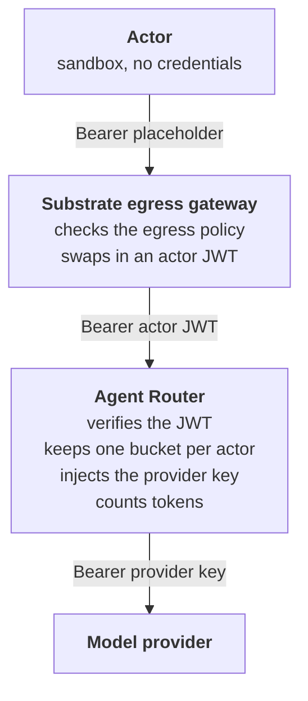

[Agent Substrate](https://github.com/agent-substrate/substrate) gives every agent a verified
identity. Agent Router counts the tokens every model call spends. Connect the two and each agent
gets its own token budget from a single rate limit rule, with no custom services and no provider
key in the sandbox.

We built this as a
[runnable example](https://github.com/theagentrouter/agent-router/tree/main/examples/agent-substrate).
It sets up Substrate, Envoy Gateway and Agent Router on a kind cluster, runs against a mock model
so you don't need an API key, and comes with a test script. It's an example, not a new feature, and
we'd like to know whether it solves a problem you have. There are some questions for you at the end.

<!-- truncate -->

## What a per-agent budget needs

When agents share a provider key, any spending limit on that key is shared too. One agent stuck in
a loop can use up the budget for all the others, and the provider's usage report can't tell you
which agent it was.

Substrate runs agents as _actors_, each in its own gVisor or microVM sandbox, and sends their
outbound traffic through an egress gateway. That gateway decides what each actor may reach, and can
add credentials to approved requests so they never enter the sandbox. It can also mint a short-lived
JWT that names the actor. What Substrate doesn't know is what a model call cost, because that number
is in the model's response.

Agent Router reads that response, so it knows what each call cost. It only needs to be told who
made the call, and the JWT does that.

Together, they cover the three things a per-agent budget needs:

| Piece       | The question it answers       | Where it comes from here                                                                     |
| ----------- | ----------------------------- | -------------------------------------------------------------------------------------------- |
| Bucket key  | Which agent is this?          | The subject of a JWT signed by Substrate, verified at the gateway                            |
| Counter     | How many tokens has it spent? | Envoy Gateway's rate limit service and Redis, charged with the token count from Agent Router |
| Bucket size | How many tokens may it spend? | The `limit` on the rate limit rule                                                           |

## How it fits together



The arrows show the `Authorization` header at each hop. Substrate answers _who is calling_ and
_whether it may reach Agent Router at all_. Agent Router answers _how many tokens it may spend_, and
holds the provider key.

## The configuration

Agent Router runs on Envoy Gateway, so most of this is standard Envoy Gateway policy. These are the
four parts that matter. The [docs page](/docs/next/capabilities/traffic/agent-substrate) walks
through the full setup.

**Put a JWT on the actor's requests.** This Substrate egress policy lets an actor reach Agent
Router, and replaces the `Authorization` header it sends with a 15-minute JWT:

```yaml
rules:
  - http:
      hostnames: ["agent-router.envoy-gateway-system.svc.cluster.local"]
      effects:
        replaceHeaders:
          - header: Authorization
            prefix: "Bearer "
            actorJwt:
              audiences: ["agent-router"]
              expirationSeconds: 900
```

The token's subject names the actor, such as `actor/agents/actor-a`. It carries identity only, with
no budget in it.

**Verify the JWT and copy out the identity.** A `SecurityPolicy` checks the token against Substrate's
published keys and copies the subject into a header. We named it `x-actor-id`. If the agent sends
its own `x-actor-id`, this replaces it.

```yaml
jwt:
  providers:
    - name: agent-substrate
      issuer: https://idp.ate-system.svc
      audiences: [agent-router]
      remoteJWKS:
        uri: https://idp.ate-system.svc/openid/v1/jwks
        backendRefs:
          - group: gateway.envoyproxy.io
            kind: Backend
            name: substrate-idp
            port: 443
      claimToHeaders:
        - header: x-actor-id
          claim: sub
```

**One rate limit rule for every actor.** This `BackendTrafficPolicy` rule is the core of the
example. The 500 is deliberately small so the demo runs out quickly.

```yaml
rateLimit:
  type: Global
  global:
    rules:
      - clientSelectors:
          - headers:
              - name: x-actor-id
                type: Distinct # a bucket per actor
        shared: true # one bucket across every route on the Gateway
        limit:
          requests: 500 # tokens per actor per day
          unit: Day
        cost:
          request: { from: Number, number: 0 } # check on the way in, don't spend
          response: # charge the reported tokens at the end
            from: Metadata
            metadata:
              namespace: io.envoy.ai_gateway
              key: llm_total_token
```

`Distinct` creates a bucket for each value of the header, so there's no list of actors to maintain:
a new actor needs no change on the Agent Router side. Without `shared: true`, each route rule has
its own bucket, and a budget per actor quietly becomes a budget per actor per model. The token count
comes from [`llmRequestCosts`](/docs/capabilities/traffic/usage-based-ratelimiting) on the
`AIGatewayRoute`.

**Keep the JWT away from the provider.** Envoy Gateway forwards the verified JWT upstream, so remove
it on the `AIServiceBackend`:

```yaml
headerMutation:
  remove:
    - authorization
```

Agent Router sets the provider key after this removal, so this is safe on every backend. We found
this one by testing. OpenAI-style backends overwrite `Authorization` with the key anyway, but a
backend that authenticates with `x-api-key` (`AnthropicAPIKey`) received the actor's JWT until we
added these lines.

With the parts not shown here (trust for Substrate's signing keys and a fixed Service name), that's
five Kubernetes resources and one Substrate policy per actor, about 130 lines of YAML on top of a
basic Agent Router install. You do need Envoy Gateway's global rate limiting turned on, which uses
Redis.

## What we tested

`test.sh` makes its calls from inside the sandboxes, through the real path. The mock model reports
200 tokens per response, and each actor has 500 tokens per day. Here's part of a run, with some
fields trimmed. `remaining` is the value before the call is charged.

```text
[PASS] 1. Actor A and actor B each complete a call; tokens are metered per actor
       rate limit counters: actor-a=200 actor-b=200
       credential the model received: actor-a=provider-key actor-b=provider-key
[PASS] 2. Actor A sends x-actor-id: actor/agents/actor-b and is still charged as actor A
       upstream saw x-actor-id: actor/agents/actor-a
       actor-a counter 200 -> 400; actor-b counter 200 -> 200
[PASS] 3. Actor A's 4th call gets 429 (500 tokens/day, 200 per call); actor B still gets 200
       actor-a call 3: {"status":200,"total_tokens":200,"remaining":"100"}
       actor-a call 4: {"status":429,"total_tokens":null,"remaining":"0"}
       actor-b:        {"status":200,"total_tokens":200,"remaining":"300"}
```

Actor A spends its budget and gets `429` on its fourth call, while actor B, with its own bucket, keeps
working. Here's the full list of what the script checks:

| When a caller...                                                         | What happens                                                                                                                           |
| ------------------------------------------------------------------------ | -------------------------------------------------------------------------------------------------------------------------------------- |
| Makes a normal call                                                      | Its tokens are counted against its own bucket, and the model receives Agent Router's provider key                                      |
| Spends its budget                                                        | Its next call gets `429`, and other agents keep working                                                                                |
| Sends `x-actor-id` claiming to be another agent                          | The header is replaced with the verified identity, and the call is charged to the real caller                                          |
| Has no egress rule for Agent Router                                      | The name doesn't resolve in its sandbox, dialing the Service IP gets a connection reset, and nothing reaches Agent Router              |
| Isn't an actor at all, and sends no token, a forged JWT or a bare header | `401`                                                                                                                                  |
| Streams its response                                                     | It's charged when the stream ends, even though the agent didn't ask for usage: Agent Router adds `stream_options.include_usage` itself |

## What it costs

The full path (both hops, the JWT check and the rate limit check) added about 3 ms at the median and
5 ms at p95, over 2,000 non-streamed calls. That's a kind cluster on a laptop (Docker Desktop on
Apple Silicon, 8 CPUs, 24 GiB) with a mock that answers instantly, so take it as a rough figure.
Real model calls take far longer than this.

`setup.sh` reached its first successful call in three to seven minutes across our runs, on the same
laptop with warm build caches. It builds Substrate from source, so expect longer with cold caches.
We haven't timed that.

## What to watch for

- **Budgets can overshoot by one response.** Tokens are charged when a response ends, and a request is
  admitted as long as the bucket isn't over the limit. So a budget of N tokens at C tokens per call
  allows `floor(N/C) + 1` calls. In the demo, 500 tokens allows three calls of 200.
- **A day is a UTC day.** Budgets reset at 00:00 UTC, not 24 hours after first use.
- **The agent has to send an `Authorization` header.** Substrate's egress gateway replaces the
  header and doesn't add one. Any value works, so "no credentials in the agent" literally means
  `Bearer placeholder`. With no header, there's no JWT, and Agent Router returns `401`.
- **The provider sees the actor's ID.** `x-actor-id` travels upstream with the request, so a real
  provider would see names like `actor/agents/actor-a`. Keep the header on the request: the rate
  limit reads it again to charge the response, so if you remove it with `headerMutation`, nothing
  gets charged.
- **Agents have to call Agent Router's URL.** Point the agent's model base URL at Agent Router, and
  don't give actors egress rules to the providers. Without a rule, a provider's name won't even
  resolve inside the sandbox.

## Different budgets for different agents

The example gives every actor the same budget. The bucket key already identifies each actor, so a
different budget size is a question of where the number comes from:

- **Per-actor rules, in gateway config.** When several rules match a request, all of them apply. So
  add a rule with an `Exact` match on the actor and its own `limit`, and exclude that actor from the
  default rule with `invert: true`. We tested this on Envoy Gateway v1.9.3 with one actor at 500
  tokens and another at 5,000, and it needed no extra service. The example's
  [README](https://github.com/theagentrouter/agent-router/tree/main/examples/agent-substrate#different-budgets-per-actor)
  has the YAML. Envoy Gateway's API key authentication can also put the client ID in a header
  (`apiKeyAuth.forwardClientIDHeader`), so the same kind of rule can key on an API key instead.
- **Per-value overrides, proposed.** An open Envoy Gateway pull request,
  [envoyproxy/gateway#9771](https://github.com/envoyproxy/gateway/pull/9771), would let a `Distinct`
  rule list per-value limits without the `invert` bookkeeping.
- **Budgets from another system.** To change budgets without touching gateway config, a rule can read
  its limit from request metadata (`limit.fromMetadata`), written by an ext_authz service that looks
  up the actor.

Our first version of this demo used that last option, with about 185 lines of Go for the lookup
service. It worked, but we took it out: the actor's identity was already the bucket key, and the
service only earned its place if budgets had to change outside gateway config. If that's your
situation, it's still a good option, but you don't need it to get started.

## Try it

You need Docker, `kubectl`, `helm`, `go`, `git`, `jq` and `curl`, and about 15 GB of free disk:

```shell
git clone https://github.com/theagentrouter/agent-router.git
cd agent-router/examples/agent-substrate
./setup.sh   # builds Substrate from source, so it takes a few minutes
./test.sh    # 6 checks, each printing PASS or FAIL with evidence
./cleanup.sh # deletes the kind cluster
```

We ran it with Agent Router v1.2.1 and Envoy Gateway v1.9.3, against the mock model and not a real
provider. Substrate is pre-1.0 and its APIs change, so the example pins a commit. The
[README](https://github.com/theagentrouter/agent-router/tree/main/examples/agent-substrate) lists
every version and has a step-by-step walkthrough.

## Tell us what you think

Neither project needed a code change for this, and we'd like to know whether it's worth taking
further. If you run agents on Substrate, or on anything else that gives them an identity, we'd love
to hear from you:

- Would you use this, and what's missing?
- Is the same budget for every agent enough, or do you need a different size per agent?
- Should budgets live in gateway config, or in a system you already have?

Find us on [Discord](https://discord.gg/xuxtPq43gZ), or
[open an issue](https://github.com/theagentrouter/agent-router/issues).
