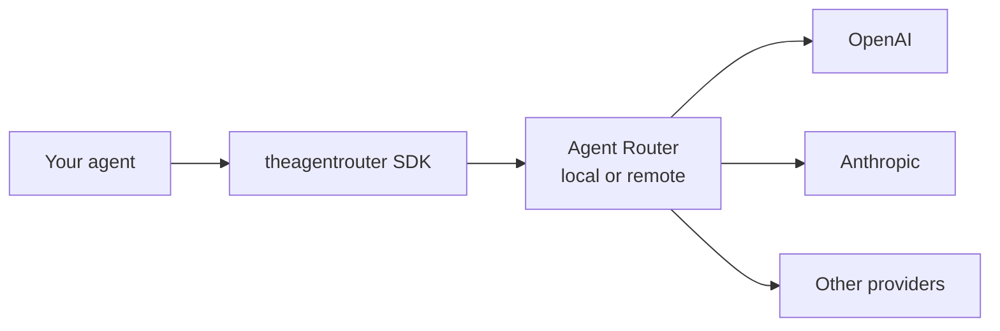

# Agent Router Python SDK

The [Agent Router Python SDK](https://github.com/theagentrouter/agent-router-python)
(`theagentrouter` on [PyPI](https://pypi.org/project/theagentrouter/)) lets
Python agents call AI models with LiteLLM's API while every call goes through
Agent Router. The SDK never calls a provider itself: the gateway handles
fallbacks, retries, request limits and provider keys. The one exception is
LiteLLM's `api_base` argument: a call that sets it goes straight to that address,
in the provider's own format, and skips Agent Router unless the address is an
Agent Router gateway.



- **Already using LiteLLM?** Change one import. Functions, arguments, responses
  and errors stay the same.
- **No gateway to set up on your laptop.** On macOS (Apple silicon) and recent
  Linux, the first call starts a local Agent Router (`aigw`) for you. Elsewhere,
  calls go to a [remote gateway](#use-a-remote-gateway).
- **The same code runs against a shared gateway.** Set two environment variables
  and calls go to the Agent Router your team runs, with provider keys kept there.

## Quick start

You need Python 3.10 or newer, a key for at least one provider, and a computer
that [runs the local gateway](#installation). The very first call also downloads
Envoy (about 100 MB, into `~/.local/share/aigw`), so it needs internet access and
can take a minute; later starts take a few seconds.

```shell
pip install theagentrouter
export ANTHROPIC_API_KEY=...
```

```python
import theagentrouter

resp = theagentrouter.completion(
    model="anthropic/claude-sonnet-5-5",
    messages=[{"role": "user", "content": "Summarise yesterday's refunds"}],
)
print(resp.choices[0].message.content)
```

The first call starts a local gateway on your computer, which calls the
provider with the key from your environment. Model names are `provider/model`,
as in LiteLLM, and the local gateway reads each provider's key from its usual
environment variable (`OPENAI_API_KEY`, `ANTHROPIC_API_KEY`, `GEMINI_API_KEY`,
AWS credentials for Bedrock, and so on).

OpenAI's Responses API, Anthropic's Messages API and embeddings work the same
way, as in LiteLLM:

```python
resp = theagentrouter.responses(model="openai/gpt-5.4-mini", input="Summarise yesterday's refunds")

resp = theagentrouter.anthropic.messages.create(
    model="anthropic/claude-sonnet-5-5",
    max_tokens=1024,
    messages=[{"role": "user", "content": "Summarise yesterday's refunds"}],
)

vectors = theagentrouter.embedding(model="openai/text-embedding-3-small", input=["refunds", "returns"])
```

Streaming, async calls (`acompletion`, `aresponses`, …), tools and structured
output work as in LiteLLM, except that `responses` and `aresponses` do not stream
yet. The local gateway serves OpenAI, Anthropic, Gemini API, Groq, Mistral,
DeepSeek, Together, Bedrock and Azure OpenAI models; Vertex AI is not served yet.
See the SDK's
[usage guide](https://github.com/theagentrouter/agent-router-python/blob/main/docs/usage.md).

## Installation

There are two packages, both imported as `import theagentrouter`:

| Package               | What it installs                            | Use it on                                                                  |
| --------------------- | ------------------------------------------- | -------------------------------------------------------------------------- |
| `theagentrouter`      | The SDK and the local gateway (about 80 MB) | A developer computer                                                       |
| `theagentrouter-core` | The SDK alone                               | Servers, containers, serverless functions and CI that use a remote gateway |

The local gateway runs on macOS 13 or newer on Apple silicon, and on Linux with
glibc 2.36 or newer (x86-64 and Arm). Everywhere else, including Windows,
`pip install theagentrouter` installs the SDK alone, and calls need a
[remote gateway](#use-a-remote-gateway).

## Fallbacks and retries

A route is a model name of your own with the models behind it, in order. The
local gateway calls the first model, retries it on failure, then moves on to the
next one. The gateway needs a key for every provider in a route, so this example
needs `OPENAI_API_KEY` as well as `ANTHROPIC_API_KEY`:

```python
import theagentrouter as ar

ar.route(
    "chat",
    primary="openai/gpt-5.4",
    fallbacks=["anthropic/claude-sonnet-5-5"],
    retry=ar.Retry(attempts=2),
    limit=ar.Limit(60, per="minute"),
)
ar.completion(model="chat", messages=[{"role": "user", "content": "hi"}])
```

A call to `chat` goes to `openai/gpt-5.4`. If it cannot be reached or answers
with 429, 500, 502, 503 or 504, the gateway retries it up to two more times, then
tries `anthropic/claude-sonnet-5-5` the same way. The limit lets 60 requests a
minute through and answers the rest with a `RateLimitError`.

The SDK sends a single request named after the route: the retries, fallbacks and
limits run in Agent Router, not in your process. Routes are saved in
`~/.agentrouter/routes.json`, so every program on the computer shares them.
LiteLLM's `Router`, with its `fallbacks` and `num_retries`, is turned into
routes too.

## Use a remote gateway

The local gateway is for development. To send calls to an Agent Router your team
runs, for example one deployed [on Kubernetes](./getting-started/index.md#deploy-on-kubernetes)
or with [`aigw run`](./cli/run.md), set its address and client key:

```shell
export AGENTROUTER_BASE_URL=https://gateway.example.com/v1
export AGENTROUTER_API_KEY=... # the gateway's key, not a provider's
```

With these set, the local gateway never starts and no provider keys are needed
on the computer: they stay on the gateway. Calls use the gateway's standard
endpoints, so any Agent Router configuration that serves them works:

| SDK call                        | Gateway endpoint         |
| ------------------------------- | ------------------------ |
| `completion` to Claude models   | `/anthropic/v1/messages` |
| `completion` to any other model | `/v1/chat/completions`   |
| `responses`                     | `/v1/responses`          |
| `anthropic.messages.create`     | `/anthropic/v1/messages` |
| `embedding`                     | `/v1/embeddings`         |

A call to a route sends the route's name, so the gateway's own route of that name
applies. To run on a server the same routes and models you tested locally,
`local_gateway.export_config()` returns an `aigw` configuration built from them.
Save it to a file and run it with `aigw run`. The exported gateway checks one
shared client key: set `AGENTROUTER_API_KEY` on the server too, to the same value
your clients use, along with the provider keys:

```python
from pathlib import Path
from theagentrouter import local_gateway

Path("config.yaml").write_text(local_gateway.export_config())
```

## Coming from LiteLLM

```python
from theagentrouter.compat import litellm   # was: import litellm
```

Change this one import and the rest of your code stays the same. The SDK has only
the LiteLLM functions that agent frameworks use, so image generation, speech,
files and batches are not available. The full list is in
[Coming from LiteLLM](https://github.com/theagentrouter/agent-router-python/blob/main/docs/coming-from-litellm.md).

## Agent frameworks

Frameworks that reach models through LiteLLM can use the SDK without LiteLLM
installed. Call `install_as_litellm()` before importing the framework, and
`import litellm` loads the SDK instead:

```python
from theagentrouter.compat import install_as_litellm
install_as_litellm()

from google.adk.agents import Agent
from google.adk.models.lite_llm import LiteLlm

agent = Agent(
    name="refunds",
    model=LiteLlm(model="anthropic/claude-sonnet-5-5"),
    instruction="Answer questions about refunds.",
)
```

Google ADK and the OpenAI Agents SDK are tested. See
[Agent frameworks](https://github.com/theagentrouter/agent-router-python/blob/main/docs/frameworks.md)
for the details and the status of other frameworks.

## Learn more

- [Install](https://github.com/theagentrouter/agent-router-python/blob/main/docs/install.md):
  packages, checking the install, upgrading and removing
- [Usage](https://github.com/theagentrouter/agent-router-python/blob/main/docs/usage.md):
  models and keys, streaming, tools, errors, cost, gateways and settings
- [How the local gateway works](https://github.com/theagentrouter/agent-router-python/blob/main/docs/local-gateway.md):
  its files, how to stop it, and its known limits
- [Examples](https://github.com/theagentrouter/agent-router-python/tree/main/examples)
